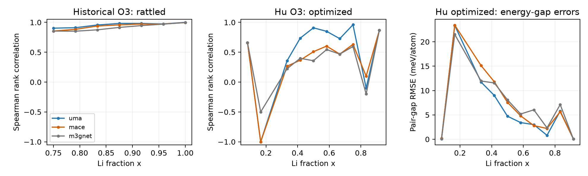
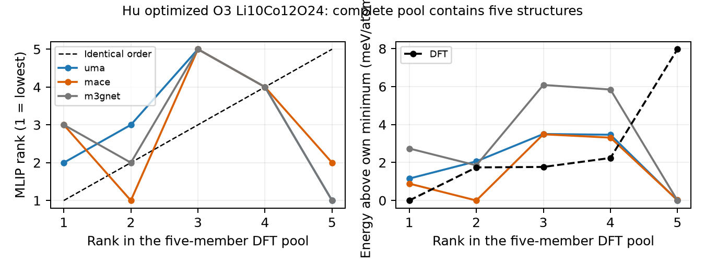

# Evidence, measured results, and limits

The frozen binary-CVAE comparison, the matched DFT audit, and the new multibin
campaign are separate experiments. Numerical claims must name the experiment,
teacher, geometry protocol, reference pool, and novelty boundary. New campaign
results below use completed score/evaluation receipts and independent raw-input audits.

## Frozen final controlled-study assessment

Development selected graph encoder plus strict-past decoder context before the
final manifest and 278,382-orbit known-history boundary were frozen. There are
34,560 final UMA attempts across ten families; a prespecified six-family subset
of exactly 20,736 identical attempts was also scored by MACE. No final outcome
changed model selection or thresholds. All attempts are valid exact-count masks;
there are 27,844 distinct generated orbits across the full pool. Unique proposals
are not all novel to the frozen history, and attempt counts are not scoring-call
counts.

| Frozen-final method | UMA balanced useful yield (%) | MACE balanced useful yield (%) | UMA original-q20 low (%) |
| --- | ---: | ---: | ---: |
| Dense D4 | 31.05 ±0.81 | 31.25 ±0.99 | 30.30 |
| Dense + symmetry augmentation | 33.19 ±1.10 | 33.16 ±1.14 | 29.08 |
| Graph encoder only | 34.43 ±0.18 | 34.55 ±0.09 | 25.09 |
| Graph encoder + causal context | **62.04 ±1.70** | **63.45 ±1.51** | **63.54** |
| Uniform | 34.14 ±0.36 | 34.03 ±0.17 | 19.97 |
| Frozen mutation | 58.62 ±0.51 | 57.29 ±0.78 | 52.52 |

These are equal means over composition/bin cells and then three fit or sampler
replicates. The ± values are descriptive seed standard deviations. UMA balanced
gain over mutation is 3.41 percentage points; its requested-low/original-q20 gain
is 11.02 points. MACE original-q20 low yields are 67.62% for context, 52.95%
mutation, 20.57% uniform and 34.98% dense D4. MACE labels the same proposals using
its own training-derived schema; this is a second-teacher audit of an
UMA-conditioned generator, not another retrained model or independent DFT truth.

Sources: [full UMA summary](../runs/conditioning_20261107/evaluation/final/summary.csv),
[matched UMA/MACE summary](../runs/conditioning_20261107/evaluation/final_matched/summary.csv),
[separate matched low metric](../runs/conditioning_20261107/evaluation/final_matched/fixed_q20_low_request.csv),
and [frozen final protocol](../runs/conditioning_20261107/final_protocol.json).
The full table also retains D8/16/32 and the no-latent dense AR control; no family
is omitted from the archived final assessment because of its outcome.

An [independent raw-input checker](../reports/conditioning_20261107/independent_final_metrics/receipt.json)
recomputed canonical identities with all 192 operations, exact counts, bins,
novelty and outcomes without the production evaluator helpers. All 16 final
tables agree: 2,515,436 field checks, zero mismatches, maximum floating difference
1.11e−16. This is a numerical reproducibility check; it does not make teacher
energies physically correct or replace the collaborators' assigned checks.

### Structural distance and the limits of a diversity claim

The [label-free distance audit](../reports/conditioning_20261107/final_structural_distances/receipt.json)
uses all 34,560 attempts. It exactly minimizes site Hamming distance over all 192
parent operations and a fixed 1024-training-orbit reference per composition.
Because that reference is a subset, the result is an **upper bound** on distance
to the full training set; it does not prove a positive full-training distance.
Means are 6.858 changed sites for context, 6.850 for dense D4, 6.891 for uniform
and 6.498 for mutation. This comparison does not indicate a substantial neural
structural-distance gain. Mutation's actual seed/child raw Hamming mean is 4.037
sites (symmetry-minimized 4.034); all 3456 recorded edits exactly equal twice
their declared swap count. Distances are site counts, not Å. The audit read no
energy labels, changed no selection and required no MLIP calls.

The strong conditional response and nearly unused latent pathway described
below concern the same trained checkpoints. They remain essential qualifications
of the positive final yield: the benefit of the variational channel is unresolved.

## Optional assessments after the required gate

These use new declared histories and do not replace the frozen core comparison.
The [optional supplement](OPTIONAL_EXTENSIONS_20261107.md) provides methods,
all nine terminal-minimum comparisons, costs, figures and exact commands.

| Optional comparison | Main observed outcome | Separate limitation |
| --- | --- | --- |
| Same-seed learned editor versus mutation | Balanced yield 59.375% versus 57.234%; original-q20 low 50.347% versus 50.521% | Low-request paired mean favors mutation by 0.07656 meV/atom; learned best novel minimum is lower in 7/9 cases at 128 attempts, a secondary posthoc observable |
| Dense-D4 posthoc Gaussian versus standard prior | UMA balanced 34.259% versus 31.047%; MACE 34.028% versus 30.787% | Low-request q20 yields fall: UMA 23.958/30.122%, MACE 26.042/32.552%; no recommendation change |
| Temperature allocation follow-up | 24 schedules/768 attempts/102 distinct geometries; allocations and paired realizations identical across four temperatures | Static reference ESS 1.850–6.544; no resolved temperature-dependent generation or thermodynamic calibration |
| Two defined-hop UMA NEB paths | Numerically converged coarse forward spans 0.638/0.192 eV per hop | Event1 seven-image/tighter-force refinement gives 0.189 eV; coupled sensitivity is −0.450 eV, not a validated transport barrier |

The editor uses matching raw seed identities, exact 1/2/3-swap budgets and actual
uniform arrays, with all 6,912 attempts retained. Its minima comparison uses the
best current-SCF seed from each case's supplied paired seed set, not the global
minimum of all training/history configurations. The three composition-mean
best-child advantages over mutation are −0.572/−0.229/−0.428 meV/atom. This tail
behavior coexists with tied low-quintile yield and less favorable paired average;
neither a blanket positive nor a blanket negative energy conclusion is supported.
The independent [editor audit](../reports/conditioning_20261107/independent_editor_metrics/receipt.json)
and [low-request posthoc](../reports/conditioning_20261107/editor_low_request_v2/receipt.json)
bind those separate observables.

The Gaussian proposal study computes TRAIN-only condition-specific posterior
moments after fitting; it performs no neural optimization. It is not a trained
conditional-prior CVAE or exact aggregate-posterior mixture. Its paired streams
share base epsilon and AR uniforms, while the actual latent vectors differ by
condition and proposal law. The new known-history boundary is 312,715 orbits.
The [independent prior audit](../reports/conditioning_20261107/independent_aggregate_prior/receipt.json)
checks actual transformed latents and TRAIN membership/matrix identities;
per-row encoder moments were not saved for independent re-encoding. Separate
matched UMA/MACE schemas and all 6,912 attempts per teacher are retained.

The defined-hop NEB pilot is a separate MLIP potential-energy label-feasibility
study. Its terminal receipts, convergence/image checks and physical limits are
reported separately; teacher agreement on occupation energies does not validate
saddle-point forces or DFT barriers.
The MACE check evaluates seven single points on event1's **five-interior** UMA
band and does no MACE optimization. Its 0.640 eV forward profile span does not
validate the refined seven-image path. See the
[full profiles](../reports/conditioning_20261107/neb_pilot/results/profiles.pdf)
and the supplement's residual/units explanation.

## Controlled-study development evidence (new goal)

The current [frozen protocol](../artifacts/conditioning_20261107/protocol.json)
and [actual ledger](../reports/conditioning_20261107/experiment_ledger.json)
keep required, optional and incomplete work separate. This development comparison
selects training policy; it is not the later final assessment. Previous numerical
results below retain their own histories, budgets and thresholds.

Six multibin D8 trajectories completed exactly 4,000 updates each: three fit seeds
with train class balancing off and three with it on. Training beta warms to 0.1.
Both checkpoint rules are applied to each trajectory, so four policy rows do not
mean twelve independent full fits.

| Train balancing | Validation selection beta | UMA balanced useful yield (%) | Requested-low/original-q20 yield (%) |
| --- | ---: | ---: | ---: |
| Off | 1 | 29.28 ±1.91 | 27.95 |
| Off | 0.1 | 30.44 ±0.66 | 30.90 |
| On | 1 | 30.61 ±0.27 | 31.42 |
| On | 0.1 | **32.12 ±0.63** | 30.73 |
| Uniform fixed count | — | 33.62 ±0.66 | 21.35 |
| Frozen bin-seeded mutation | — | **58.97 ±1.91** | **51.74** |

The predeclared rule selects balancing plus validation beta 0.1 by balanced
requested-bin yield, even though a different rule has the highest requested-low
CVAE result. The selected CVAE still loses to both controls on balanced yield.
The ± values are descriptive standard deviations across three fits/sampler
replicates, not confidence intervals from the proposal draws.

The pool contains 10,368 primary and 3,456 diagnostic attempts, with 12,153 unique
geometries and complete exact UMA coverage. The initial known history has 239,867
orbits. There are 11,924 fresh geometry labels and 229 exact certified cache hits;
actual resource cost is recorded separately by the integrating campaign receipt.
The generic evaluator's earlier absent-provenance cost field is not used as a
physical call count; its repaired replay preserves scientific metrics.

Two outcome definitions remain separate. With three exhaustive bins, any
condition-independent proposal distribution has average hit rate 1/3 before
novelty filtering: the three class probabilities sum to one. It can therefore
favor low energies while showing weak balanced control. Novelty/repeats can
reduce useful yield further. Requested-low enrichment alone does not prove
reliable low/middle/high controllability.

Paired diagnostics for the selected policy use common latent draws and AR
uniforms across energy requests. Observed per-seed/per-composition mean high-minus-
low shifts range from −0.370 to +0.776 meV/atom. Both signs occur. Changing latent
vectors at fixed uniforms changes 12.26 sites on average; selected validation KL
is 13.90–15.43 nats and all eight pooled components exceed the descriptive encoded-mean
variance cutoff 0.01, with six to eight within each composition. This is evidence against complete unused-latent collapse,
not proof of useful energy targeting. The exact paired tables and fit-manifest-
scoped plots are under
[`policy_diagnostics_v2`](../reports/conditioning_20261107/policy_diagnostics_v2/receipt.json).

The latent-size development comparison is now complete. Three fits per new
size 4/16/32 and three no-latent AR fits completed 4000 updates; D8 reuses the
selected policy trajectories. All methods were assessed under one new namespace
and the same 239,867-orbit history. Different D8 yields across these two development
pools therefore reflect new draws, not another update to its weights.

| Model | Trainable parameters | Balanced UMA yield (%) | Requested-low/original-q20 (%) |
| --- | ---: | ---: | ---: |
| CVAE D4 | 30,793 | **32.64 ±0.30** | **33.16** |
| CVAE D8 | 32,337 | 29.98 ±1.41 | 29.34 |
| CVAE D16 | 35,425 | 28.82 ±1.83 | 27.43 |
| CVAE D32 | 41,601 | 32.47 ±0.35 | 31.42 |
| AR without latent | 14,209 | 34.32 ±0.61 | 22.05 |
| Uniform | — | 33.04 ±1.84 | 19.62 |
| Frozen mutation | — | **59.72 ±3.09** | **52.08** |

The dimension rule was frozen before this comparison: choose the smallest size
within one percentage point of the best balanced mean and two points of the best
requested-low mean. These are provisional practical margins, not confidence
intervals or physical convergence tolerances. D4 is selected; the results do not
justify an automatic D64 extension. All individual seed values are saved in
[`seed_values.csv`](../reports/conditioning_20261107/latent_development/seed_values.csv).
Parameter counts include the training encoder; it is absent during prior sampling.
The AR baseline has the higher observed balanced mean but substantially lower
low-request yield than D4, and neither matches mutation on both outcomes.

## Completed spatial development comparison

The retained D4/balancing/selection policy is held fixed. All learned variants
complete 4000 updates per fit. The initial graph-context seed was replicated at
two further seeds under the pre-final
[protocol amendment](../artifacts/conditioning_20261107/protocol_amendment_graph_context_replication.json),
bringing the required core to 28 full fits within its 30-fit cap. Optional editor
fits, if executed later, are separately scoped and are not counted as core fits.

| Method | Balanced UMA useful yield (%) | Requested-low/original-q20 (%) |
| --- | ---: | ---: |
| Dense encoder | 31.83 ±1.05 | 29.69 |
| Dense + symmetry augmentation | 32.12 ±0.97 | 29.34 |
| Graph encoder only | 34.49 ±1.41 | 24.31 |
| Graph encoder + causal decoder context | **60.88 ±1.82** | **61.11** |
| Uniform | 32.75 ±0.50 | 19.79 |
| Frozen mutation | 58.80 ±0.53 | 50.35 |

Sources are the confirmed development
[summary](../runs/conditioning_20261107/evaluation/spatial_confirmed/summary.csv),
[separate low metric](../runs/conditioning_20261107/evaluation/spatial_confirmed/fixed_q20_low_request.csv),
and [seed rows](../runs/conditioning_20261107/evaluation/spatial_confirmed/seed_metrics.csv).
The three graph-context balanced replicate yields are 59.03/60.94/62.67%; mutation
gives 58.68/59.38/58.33%. These are three fit/sampler replicates and descriptive
variation, not a proposal-level confidence interval or an independent final win.
All rows share the 239,867-orbit history. Reused dense weights were assessed on
this namespace's draws; their changed numbers are not additional training.

The intervention is graph encoder **plus** causal decoder features versus the
same graph encoder without those features. It is not a dense-plus-features test.
The graph-encoder and context models have 36,669 and 37,821 trainable parameters,
respectively. Symmetry augmentation alone produces only a small observed change.
The fresh final assessment must be evaluated before making a final-family claim.

### Conditional control improves while latent use diminishes

The confirmed [paired diagnostic receipt](../reports/conditioning_20261107/spatial_confirmed_diagnostics/receipt.json)
and [family summary](../reports/conditioning_20261107/spatial_confirmed_diagnostics/family_diagnostic_summary.json)
retain all seed-level values. Holding latent draws and AR uniforms fixed,
graph-context high-minus-low requests shift UMA energy upward by 5.263 meV/atom
on average, with 97.40% positive shifts. Middle-minus-low shifts average
2.100 meV/atom, positive in 85.24%. Dense D4's means are +0.026/−0.135 meV/atom;
graph-encoder-only gives +0.259/+0.121. The
[condition-response plot](../reports/conditioning_20261107/spatial_confirmed_diagnostics/condition_response.pdf)
shows individual seeds and compositions. Positive energy shifts show that the
model responds to the requested order; they do not establish correct physical
energy values or a calibrated probability distribution.

The graph-context checkpoints have validation KL 0.0110/0.00747/0.00907 nats.
No pooled encoded-mean component exceeds variance 0.001, 0.01 or 0.1. Resampling
the latent at fixed AR uniforms changes 0.795 sites on average, and 68.23% of pairs
remain in the same symmetry orbit. Posterior versus prior target Hamming distance
is 16.78 versus 16.81. The dense D4 model instead has KL 11.58–11.95 nats and
12.72 changed sites. These combined diagnostics support a nearly unused
variational pathway for the graph-context model. They do not imply a deterministic
generator: AR sampling still uses random uniforms. The useful new result is a
condition-sensitive spatial AR sampler, not demonstrated benefit from its latent
variables. A matched spatial AR control without a latent is a later discriminating
test, rather than an already completed comparison.

An independent audit of all three actual trained checkpoints found exact zero
future-bit gradients, unchanged logits after future-mask changes and agreement
of teacher-forced and stepwise features within recorded FP32 arithmetic bounds:
[trained causality receipt](../reports/conditioning_20261107/trained_causality_audit.json).
The full-mask encoder was forbidden in those decoder tests. This checks the
tested implementation against a future-target shortcut; it does not certify
full equivariance, final predictive performance or physical accuracy.

### The second-condition pilot remains negative

One additional fit requested low/high nearest-shell vacancy-pair fractions within
the middle-energy class. Over six composition/descriptor cells its joint useful
yield was 28.13%, versus 28.52% for plain CVAE and 44.79% for matched mutation:
[descriptor summary](../runs/conditioning_20261107/evaluation/descriptor/summary.csv).
All 2304 attempts are retained. One fit supplies no fit-to-fit uncertainty estimate.
The descriptor is strongly correlated with energy, including within the middle
bin; it is a structural-diversity request, not an independent thermodynamic
objective. The pilot does not support a claimed improvement.

## Reproduced historical occupancy result

The completed November 6 assessment used 512 attempts per method, fit seed and
Li count (n=12,24,36), with three independent CVAE fit seeds and three
random-seed replicates for sampler controls. Its yield was

$$
Y=\frac{\#\{\text{distinct proposed orbits absent from frozen history and with}
\ e\le q_{20}^{\rm original}(n)\}}{\#\{\text{all attempts}\}}.
$$

The original training q20 is fixed separately by teacher and composition.
Repeated or previously known proposals remain attempts. Uniform fixed-count
sampling is uniform over raw masks, not over symmetry representatives. These
means are historical and must not be labeled outcomes of the new multibin model.

| Historical method | UMA yield (%) | MACE yield (%) |
| --- | ---: | ---: |
| Uniform fixed-count | 18.99 | 19.75 |
| Legacy dense CVAE, top-count decoding | 17.14 | 18.66 |
| Legacy dense CVAE, β=0.1 | 20.29 | 23.57 |
| Dense original-data, Bernoulli | 22.37 | 23.81 |
| Dense original-data, exact count | 22.61 | 24.57 |
| Dense expanded-data, exact count | 27.86 | 29.58 |
| AR expanded-data, no latent | 25.17 | 27.08 |
| AR composition-only CVAE | 31.88 | 35.76 |
| AR energy-conditioned CVAE | **35.57** | **40.06** |
| Extra adaptive AR, β=0.1 | 33.81 | 38.91 |
| Extra adaptive AR, β=1 | 27.84 | 30.43 |
| Mutation, original low-energy training pool | 45.40 | 46.96 |
| Mutation, expanded low-energy training pool | 50.91 | 51.84 |
| Mutation, round-1 low-energy training pool | **52.65** | **54.08** |

Source: `artifacts/current/improvement_v1/reports/final/{metrics,seed_metrics,summary}.csv`.
The portable evaluator reproduced their fields exactly in the November 6
validation. The new execution rechecks this historical result before interpreting
new results. Three fit seeds define descriptive model variation; hundreds of
latent draws are not hundreds of independent fits.

The AR CVAE improved on random sampling but did not beat low-energy-mask mutation.
The strongest historical mutation pool also contains more labeled history than
the round-0 training set. Comparisons that change data, orientation, initialization
or schedule are complete-method comparisons, not a causal isolation of one change.

### Why more adaptation did not automatically improve yield

The extra round coupled 25,000 additional development masks, warm starts,
recomputed training classes, and class balancing. Original assessment thresholds
stayed fixed. Its lower yield is therefore not mechanically caused by tightening
the final success gate, nor does it prove extra data are intrinsically harmful.
At selected β=1 adaptive checkpoints, validation KL was about 0.19–0.35 nats,
versus 17.1–17.7 for β=0.1. This is consistent with a changed reconstruction/prior
tradeoff, not proof of complete posterior collapse. The AR decoder itself is
stochastic. A larger KL likewise does not guarantee useful prior samples.

All these fits selected checkpoints by validation reconstruction plus unit-weight
KL, including β=0.1 training. That rule can disagree with downstream discovery.
The β=0.1 update found lower individual energy extremes at some compositions
while producing fewer distinct novel low-tail structures per attempt. Report
both objectives. The present task extends the energy condition; it does not
assert that adaptation alone was repaired.

## Matched DFT ranking context, independently recomputed

`reports/ranking_audit_20261107/` recovers 34,368 saved model–geometry rows:
11,456 exact geometries evaluated by UMA, MACE and M3GNet. Each pool fixes source,
phase, composition, atom count and cohort. The historical and Hu DFT protocols
are kept separate. The source audit used FP64/general settings; the new deletion
benchmark has its own explicit FP32 teacher configuration.

The table below uses descriptive, unweighted medians across informative
composition pools. Top-quintile requests k=ceil(0.2 Npool) and includes all exact
boundary ties, with resulting set sizes recorded. Pair-gap RMSE compares energy
differences within each pool, so constant offsets cancel.

| Source / cohort | Model | Pools / frames | Median Spearman ρ | Median top-quintile precision | Median gap RMSE (meV/atom) |
| --- | --- | ---: | ---: | ---: | ---: |
| Historical O3 / rattled | UMA | 7 / 524 | 0.97366 | 96.30% | 2.047 |
| Historical O3 / rattled | MACE | 7 / 524 | 0.95808 | 88.89% | 2.755 |
| Historical O3 / rattled | M3GNet | 7 / 524 | 0.91537 | 83.33% | 3.767 |
| Hu O3 / optimized | UMA | 10 / 104 | 0.73177 | 41.67% | 4.077 |
| Hu O3 / optimized | MACE | 10 / 104 | 0.48865 | 0.00% | 5.227 |
| Hu O3 / optimized | M3GNet | 10 / 104 | 0.43317 | 0.00% | 6.576 |

High rank agreement in strongly rattled frames does not automatically imply
accurate ordering of nearly degenerate optimized vacancy configurations.
Small optimized pools often request only one structure at the low-quintile
boundary, so zero precision can coexist with moderately positive ρ. Consult
`pool_metrics.csv` and `topk_metrics.csv` for sizes, ties and DFT energy spans.
The recomputation matched 432 individual archived diagnostic fields.

### Verified five-structure counterexample

Hu's optimized O3 Li10Co12O24 pool contains exactly five geometries. UMA selects
`structure_4159` first, while DFT ranks it fifth. UMA's ρ is −0.1 and its selected
minimum has a DFT penalty of 7.9711 meV/atom relative to the best member of this
pool. MACE's ρ is 0.1 and its selected minimum's penalty is 1.7435 meV/atom. The
same five identities necessarily have perfect top-five set overlap in a
five-member pool; that is not recall from a larger unseen population.

This evidence supports an explicitly MLIP-defined class benchmark and later
matched DFT validation. It does not support the universal claim that delithiated
LCO energies differ from DFT only by a constant. Gap errors can change static
weights even with perfect ranks. Rank agreement does not validate forces,
phonons, or thermal free energies. Archived SCF/spin convergence is not recertified
from these scalar exports, and trajectory frames are correlated.

## November 7 multibin and acquisition measurements

Three multibin fits completed on the protected round-0 splits, without class
balancing, using canonical masks, latent dimension 8, GRU hidden dimension 64,
β warmup over 20 epochs to 0.1, and validation reconstruction plus unit-weight KL checkpoint
selection. They ended by validation early stopping, not the 600 s wall limit:

| Fit seed | Epochs / optimizer updates | Best epoch | Fit wall seconds |
| --- | ---: | ---: | ---: |
| 20261106 | 53 / 4,187 | 38 | 30.806 |
| 20261107 | 44 / 3,476 | 29 | 27.761 |
| 20261108 | 49 / 3,871 | 34 | 27.707 |

Source: `artifacts/overnight_20261107/fits/multibin_v2_SEED/{configuration,summary}.json`.
These are measured fit receipts; generation quality still requires the complete
proposal/score/evaluation outputs below. A100 timing does not predict class GPU
wall time, and it excludes label acquisition and assessment.

The new result set is separate from the historical table. Its frozen balanced
benchmark has **41,472 attempts and 40,662 distinct geometries**: 256 attempts
per method, composition, requested bin and design replicate. All masks are
valid and exact-count; all have current UMA and MACE labels; no requests failed.
The novelty boundary contains 40,157 training keys and 188,919 frozen historical
keys. Success requires absence from both.

| Method | UMA useful yield (%) | MACE useful yield (%) |
| --- | ---: | ---: |
| Uniform raw masks | 33.00 ± 0.65 | 33.38 ± 0.26 |
| AR, composition only | 31.73 ± 0.77 | 31.94 ± 0.85 |
| AR, binary energy | 31.92 ± 1.01 | 31.03 ± 1.11 |
| AR, three energy bins | 31.00 ± 0.81 | 31.24 ± 1.22 |
| Requested-bin seed mutation | 58.39 ± 0.61 | 57.54 ± 0.16 |
| Low-bin seed mutation | 33.93 ± 1.05 | 34.40 ± 0.82 |

Useful yield is distinct novel in-requested-bin orbits divided by all attempts,
macro-averaged equally over three compositions and requested bins, then three
design seeds. ± is descriptive standard deviation across those three seeds, not
a confidence interval. CVAEs have three fit seeds; sampler controls have three
random replicates and no trained parameters. MACE uses its own training-derived
schema. Both new mutation controls select seeds from protected round-0
training rows: the requested bin for `mutation_bin`, always low for `mutation_low`.
They do not use the historical round-1 larger seed pool.

The multibin model does **not** improve balanced controllability or useful yield.
Its UMA low/middle/high hit rates are 35.59%/54.43%/8.42%, compared with
16.02%/63.32%/19.70% for uniform sampling and 49.18%/71.48%/54.60% for bin-seeded
mutation. It favors low energies while failing to distinguish all three requested
ranges reliably. This observation does not identify the cause; training imbalance,
prior/decoder behavior and model selection require controlled checks.

On requested-low attempts, the original-q20 UMA yield is 32.99% multibin,
33.94% binary, 31.25% composition, 17.49% uniform, 51.65% bin mutation and
52.00% low-bin mutation. This retains the old teacher-specific threshold
but uses a new history, pool and 256-attempt group budget; it is not the historical
35.57% experiment.

Source: `artifacts/overnight_20261107/evaluation/benchmark/{summary,summary_by_request,
fixed_q20_low_request,metrics,seed_metrics,confusion,budget_curves}.csv` and
`receipt.json`. Complete per-attempt outcomes and canonical candidate IDs remain
available. Per-method query curves are stand-alone deduplicated costs; summing
them across methods double-counts shared labels. Actual campaign calls belong
to the cost receipt. Layer diversity here is only the standard deviation of six
Li-plane filling fractions in the fixed parent frame, not phase/basin diversity.

[UMA condition quality](../artifacts/overnight_20261107/evaluation/benchmark/figures/condition_quality_uma_fixed-balanced-bin-budget_fixed_6c7d5ec1_6c7d5ec1.pdf) and
[MACE condition quality](../artifacts/overnight_20261107/evaluation/benchmark/figures/condition_quality_mace_fixed-balanced-bin-budget_fixed_6c7d5ec1_bd5c067d.pdf)
show individual design replicates. The packet also supplies low-request proposal-
and query-budget curves.

### Executed acquisition-guided generation

All three fitted models executed the complete prespecified schedule file: 90
schedules, 11,520 attempts, 11,080 distinct geometries, zero failed requests and
complete exact-count UMA/MACE scoring. This includes pure and exploration plans
at each of four temperatures, plus both equal-temperature-mixture plans, for
each of three compositions and three fits. Each schedule has a 128-attempt
budget; mixture schedules share that total across temperatures.

| Policy scope | Attempts | Requested low (%) | Measured low UMA (%) | Measured low MACE (%) |
| --- | ---: | ---: | ---: | ---: |
| Per-temperature static | 4,608 | 100 | 36.48 | 40.26 |
| Per-temperature exploration | 4,608 | 93.75 | 35.79 | 39.24 |
| Joint-temperature static | 1,152 | 100 | 36.02 | 38.98 |
| Joint-temperature exploration | 1,152 | 93.75 | 37.15 | 40.63 |

These are attempt-weighted fractions pooled over the declared scope, not
independent physical populations. Requested floor fractions are 93.75%/3.125%/
3.125% after rounding 120/4/4; the underlying continuous weights are approximately
93.333%/3.333%/3.333%. Each teacher measures its own bins. The large gap between
requested and realized fractions is the practical consequence of weak conditional
control; an exact request budget does not fix it. Temperature changes the
allocation calculation, not the decoder or lattice geometry. The coarse requests
are the same across these temperatures and do not establish temperature-specific
generation behavior.

Source: `artifacts/overnight_20261107/demo/generation_receipt.json` and
`evaluation/demo/{receipt.json,allocation_realization.csv,allocation_joint_realization.csv,allocation_joint_summary.csv}`.
The latter deduplicates useful orbit identities across temperatures within a
joint schedule. The [requested-versus-measured figure](../reports/overnight_20261107/evaluation_audit/demo_requested_vs_measured.pdf)
and independent `benchmark_audit.json` / `demo_audit.json` checks accompany the
results.

### Measured new campaign cost

`artifacts/overnight_20261107/cost_receipt.json` is a small Git-tracked receipt,
separate from the large release ZIP. It records **127,481 new logical single-point
energy/force/stress calls**, including 24 interface-pilot calls. The primary
reference requires 24,575 UMA calls; the balanced benchmark uses 81,324
geometry–teacher pairs; the demo adds 21,558 after reusing 602 pairs already
scored in the benchmark. A logical call is an ASE energy/force/stress evaluation
for one exact geometry and teacher, not an instrumented neural-backbone forward.

The released allocations consumed **12.401111 GPU-device hours**, equivalent to
**3.100278 four-GPU-node hours**, or **3.636111 physical node-hours**. The latter
counts the shared node's elapsed time as a physical node even though only two
GPUs were reserved. All startup, failures, analysis and idle allocation time are
included. Both jobs completed and were released. Historical label-generation
costs predate this goal and remain additional costs for any end-to-end comparison;
the short fit timings do not make the project a 30-second data-generation method.
No new DFT, MLIP fine-tuning or geometry-CVAE campaign was run in this extension.

### Complete independent-reference acquisition finding

The new independent reference contains 24,576 uniform raw fixed-count draws,
8,192 at each of n=12,24,36. Collapsing a repeated orbit leaves 24,575 exact
geometries; every geometry has a finite current UMA/omat FP32 energy. Frequencies
and original draw order are retained. No orbit multiplicity is multiplied into
these already raw-mask-weighted observations.

At 433.15 K the full-pool particle ESS is 4.629, 2.271 and 5.480 for n=12,24,36;
the largest representative masses are 0.361, 0.654 and 0.299. Across all four
temperatures and three compositions ESS ranges from 1.850 to 6.544. Low-bin
mass is 99.98624%–99.99999982%; a budget of 128 therefore rounds to 128/0/0
low/middle/high requests under pure static weights, or 120/4/4 under the 10%
exploration policy. These rounded allocations are identical across all tested
temperatures and compositions; the energies change weights and ESS without
producing resolved temperature-specific bin requests at this granularity. Coarse bin mass stability does not establish adequate tail
coverage: the minimum cell energy in the 512-draw prefix is above the 8,192-draw
minimum by 0.0101, 0.1758 and 0.2459 eV for the three respective compositions.
The nested prefixes are correlated sensitivity checks, not independent repeats.

Source: `reports/overnight_20261107/reference_diagnostics/receipt.json`,
`prefix_metrics.csv`, `allocation_fractions.csv`, and `reference_population.csv`.
The receipt links exact parent/schema/model hashes and the complete score
collector. The available plots are
[requested bin fractions](../reports/overnight_20261107/reference_diagnostics/requested_bin_fractions.pdf)
and [prefix sensitivity](../reports/overnight_20261107/reference_diagnostics/prefix_sensitivity.pdf).
This measures acquisition from a finite empirical reference under static
unrelaxed UMA energies; it is not a converged physical Boltzmann population.

## Secondary geometry result retained

One displacement CVAE and one deterministic regressor were fitted on the same
fixed-cell UMA relaxation corpus. Their 128 fresh-mask direct predictions lowered
energy relative to deletion and reduced force-component RMS. A CVAE draw gave
about −19.1 meV/atom median energy change and about 24% of the deletion force RMS.
However, none of the 128 direct outputs per group met maximum force <0.05 eV/Å.
The operational maximum-force criterion is distinct from RMS and is not a
universal physical standard.

On the matched 32-mask UMA optimizer comparison, all starts converged under the
same fixed-cell protocol:

| Start | Median steps | Median wall time in that run |
| --- | ---: | ---: |
| Deletion | 40 | 3.71 s |
| Regressor | 24 | 2.19 s |
| Geometry CVAE draw 0 | 24 | 2.19 s |

The learned start helped; a CVAE-specific advantage over regression was not
established. Three latent draws from one geometry CVAE are not three model fits.
Source tables are the frozen `reports/decoded_geometry_summary.csv` and
`reports/decoded_matched_relaxations.csv`. This remains a secondary result; a
new geometry-model campaign does not replace the current multibin objective.

## Conclusions that remain outside the evidence

No present result establishes global minimum discovery, DFT accuracy of new
48-site candidates, a full density of states, physical configurational entropy,
calibrated hydrothermal populations, equilibrium reactor conditions, or downstream
MLIP fine-tuning improvement. A finite uniform-raw reference can miss rare
low-energy states. Exploration floors are chosen request policies. Correct bin
allocation does not imply correct within-bin sampling. Thermal corrections from
a separate Phase 2 pilot must not be inserted into these class results as already
validated physical free energies.
