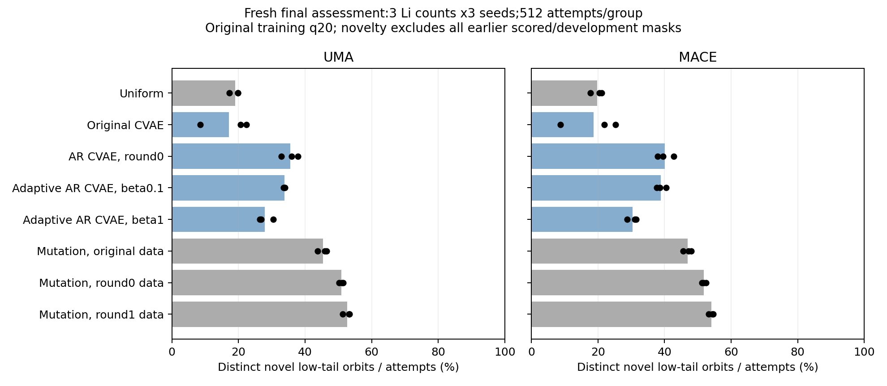
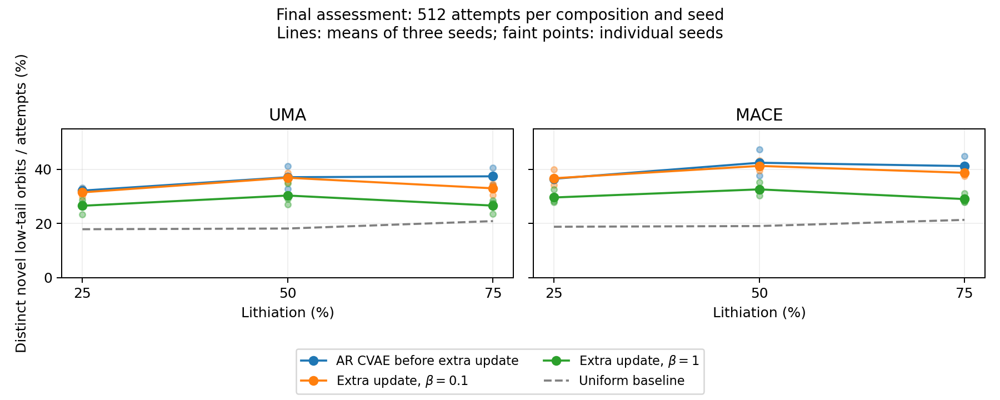
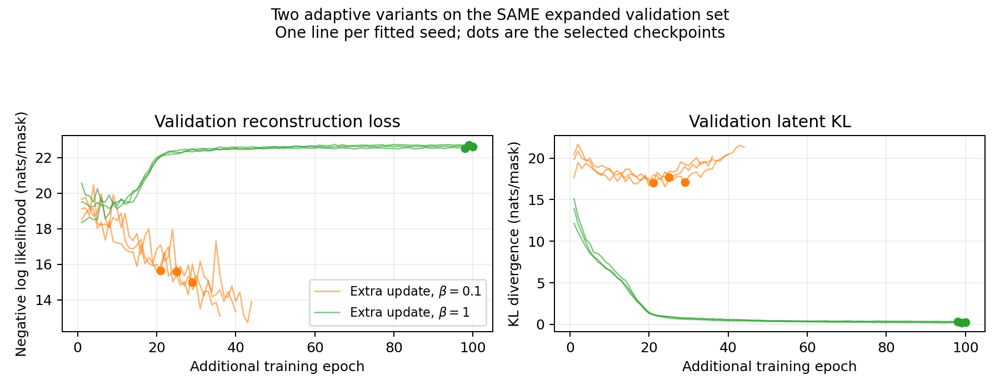
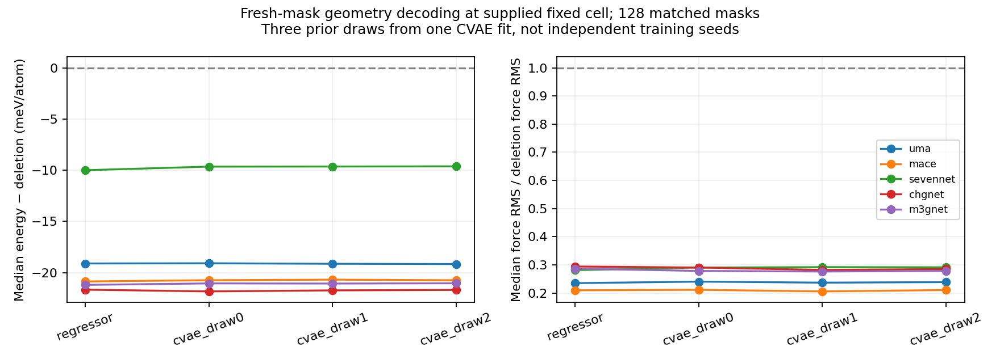

# What has been measured

These results describe MLIP-labeled structures. They establish neither DFT
ground states nor experimental recycling performance. The current complete
comparison is in `artifacts/current/improvement_v1/reports/final/`; the earlier
ten-page report is background and predates the improved AR comparison.

## Primary occupancy result

For each method, training seed, and Li count, we retained **512 generation
attempts**, including repetitions. The three Li counts were 12, 24, and 36 in
the same 48-site parent. Three independent fit seeds were used. The main yield
was

$$
Y=\frac{\#\{\text{distinct proposed orbits absent from frozen history and with}
\ e\le q_{20}^{\rm original}(n)\}}{\#\{\text{all attempts}\}}.
$$

The energy threshold is frozen from the **original training data**, separately
for each teacher and Li count. The novelty history includes original masks,
earlier proposals, and every development proposal. A generated mask must pass
both tests. Repeated successes count once in the numerator, while every draw
uses an attempt. Uniform raw fixed-count sampling is uniform over masks, not
over their symmetry orbits.

| Method | UMA yield (%) | MACE yield (%) |
| --- | ---: | ---: |
| Uniform fixed-count | 18.99 | 19.75 |
| Legacy dense CVAE, top-count decoding | 17.14 | 18.66 |
| Legacy dense CVAE, β = 0.1 | 20.29 | 23.57 |
| Dense original-data, Bernoulli loss | 22.37 | 23.81 |
| Dense original-data, exact-count likelihood | 22.61 | 24.57 |
| Dense expanded-data, exact-count likelihood | 27.86 | 29.58 |
| AR expanded-data, no latent | 25.17 | 27.08 |
| AR composition-only CVAE | 31.88 | 35.76 |
| **AR energy-conditioned CVAE** | **35.57** | **40.06** |
| Extra adaptive AR fine-tuning, β = 0.1 | 33.81 | 38.91 |
| Extra adaptive AR fine-tuning, β = 1 | 27.84 | 30.43 |
| Mutation from original low-energy training masks | 45.40 | 46.96 |
| Mutation from expanded low-energy training masks | 50.91 | 51.84 |
| Mutation from round-1 low-energy training masks | 52.65 | 54.08 |

These are means over the declared composition/seed groups. Show the individual
seed points in the report rather than treating thousands of proposals as
independently trained replications. The numerical record is
`seed_metrics.csv`, `summary.csv`, and `metrics.csv`; use the evaluation receipt
to identify the exact pool and frozen history.

The energy-conditioned AR CVAE produces roughly 1.9–2.0 times the uniform
sampler's yield. Its energy input adds useful measured performance over the
composition-only AR CVAE in this experiment. However, the strongest mutation
baseline performs better. It starts from known low-energy training masks and
exchanges occupied and vacant sites while preserving composition, so it is a
strong local-search control. The current results support continuing controlled
model development; they do not support claiming that a CVAE is already the
best low-energy search method.

The older and newer model comparisons include changes in data, orientation,
initialization, and protocol. They are comparisons of complete methods, not
proof that a particular architecture change caused the entire gain. Likewise,
the mutation baseline with the newest seed pool benefits from more labeled
training history. Report both the baseline with the matched available pool and
the strongest currently available baseline.

## Why did additional adaptation not improve the main average?

The observed result is a decrease from **35.57% to 33.81% UMA yield** under the
extra β = 0.1 update, and to **27.84%** for β = 1. MACE gives the same direction.
The Li-count averages under UMA were:

| Model | Li₁₂ | Li₂₄ | Li₃₆ |
| --- | ---: | ---: | ---: |
| AR before the extra update | 32.16% | 37.11% | 37.43% |
| Extra adaptation, β = 0.1 | 31.51% | 36.91% | 33.01% |
| Extra adaptation, β = 1 | 26.56% | 30.34% | 26.63% |

This is not evidence that more data can never help. That update changed several
things together: it added 25,000 development masks, warmed from a fitted model,
recomputed training low-class labels, and balanced the classes during fitting.
The new training thresholds were lower by approximately 0.12–0.21 meV/atom,
depending on composition. **Assessment thresholds stayed fixed**. The reported
decline therefore is not an artifact of mechanically tightening the final
success gate. Instead, the learned distribution and optimization problem
changed, and the present experiment does not isolate which change mattered.

At selected checkpoints, the β = 1 adaptive models had approximately
0.19–0.35 nats of validation KL, versus 17.1–17.7 nats for the β = 0.1 adaptive
models. Stronger KL regularization is consistent with reduced latent use and a
different reconstruction tradeoff. It does not prove complete posterior
collapse, and the AR decoder remains stochastic even without an informative
latent code. A larger KL also does not automatically demonstrate better prior
sampling. The relevant distinction between reconstruction, information, and
generation quality is discussed by [Alemi et al., §2](https://arxiv.org/abs/1711.00464).

All these fits selected checkpoints by validation reconstruction plus KL with
unit KL weight, including models trained at β = 0.1. That convention is recorded
and reproducible, but likelihood-based checkpoint selection may disagree with
the downstream discovery objective. Absolute reconstruction losses on different
validation distributions are not a clean overfitting comparison.

The β = 0.1 update did find somewhat lower *single best* energies at Li₂₄ and
Li₃₆, despite lower average novel-low-tail yield. Thus “more good unique
configurations per budget” and “the single lowest energy found” should be
reported separately. Preserve the current final pool as a completed result;
using it to choose another model would make it development evidence for that
next round.

## Novelty and locality

Orbit novelty alone does not establish broad exploration. A one-swap mutation
can be novel while remaining close to its training seed. The supplied
distance diagnostic minimizes the occupancy Hamming distance over the retained
symmetries; at fixed composition, half that distance is the number of
occupied/vacant site exchanges required to match a training mask.

On the declared deterministic **64 fresh orbits per method/seed/composition**
subset, mean distance to round-1 training masks was about 2.30 swaps for the AR
CVAE, 2.39 for its β = 0.1 adaptive version, 2.63 for uniform sampling, and 1.79
for round-1 mutation. These are sampled locality diagnostics, not an exhaustive
claim about every proposal or evidence of distinct thermodynamic basins. Use
`final_diversity64_*` and its receipt if included in the snapshot.

## Geometry prototype result

One geometry CVAE and one deterministic regressor were trained using the same
fixed-cell UMA relaxation data. The independent training unit is the vacancy
mask lineage, not a trajectory frame. The decoder was then evaluated on 128
fresh masks, with three latent draws for the CVAE. Those draws are repeated
samples from one fitted network, not three fitted model seeds.

Under UMA, all 128 outputs in each learned-start group had lower energy than
their deletion starting geometry. A CVAE draw reduced median energy by about
19.1 meV/atom and median force-component RMS to about **24%** of the deletion
value. The deterministic regressor gave a similar reduction. Other teachers
also evaluated the same decoded coordinates; these are cross-teacher
consistency checks, not new training fits.

**None of the 128 directly decoded structures per group met maximum force
< 0.05 eV/Å.** Predicting improved coordinates is therefore different from
producing a converged relaxed structure. The 0.05 eV/Å threshold is the
operational tolerance of this pilot, not a universal physical standard.

On a matched 32-mask UMA optimizer check, all three starting methods converged
under the same fixed-cell optimizer and force criterion. Median iterations were:

| Starting geometry | Median optimizer steps | Median wall time in this run |
| --- | ---: | ---: |
| Deletion | 40 | 3.71 s |
| Deterministic regressor | 24 | 2.19 s |
| Geometry CVAE, draw 0 | 24 | 2.19 s |

The learned starts help this optimizer, but the CVAE has not shown an advantage
over deterministic coordinate prediction. Wall times depend on the hardware,
model loading policy, batching, and implementation. Treat the paired step
comparison as the more portable result. Do not describe these as DFT-relaxed
structures or claim that all decoded structures are force-minimized.

Source tables are `reports/decoded_geometry_summary.csv` and
`reports/decoded_matched_relaxations.csv`. They distinguish direct prediction
from subsequent relaxation and retain final forces and endpoint energies.

## Limits that belong in the report

- All new large-cell labels here are MLIP labels. The separate historical/Hu
  DFT audits address other structures and settings; they do not automatically
  validate each new deletion geometry or decoded coordinate array.
- Lower energy at fixed composition is the current sampler target. It does not
  establish a finite-temperature equilibrium distribution, phase stability,
  electrochemical voltage, or a recycling reactor optimum.
- Exact Li count and parent-orbit novelty are checked. Physical coordinate
  validity and low residual force require additional measurements.
- Adaptive oracle calls and training cost must be included before claiming a
  net reduction in computation. This comparison has not established an
  end-to-end cost advantage over mutation.
- The architectures are tied to a parent site list. Size transfer, phase
  transfer, and cross-cathode generalization remain open.
- Only three occupancy fit seeds and one geometry fit per method were run.
  Report descriptive variation and paired checks without overstating statistical
  confidence.
