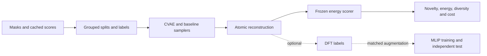

# ECE 285: conditional vacancy generation for LCO

Prepared November 2, 2026. This is a design and evidence audit, not a record of new training or simulation results. Ricardo confirmed that the guaranteed course deliverable is the sampler comparison; DFT validation and MLIP fine-tuning are extensions. Roles remain Ricardo Silva Buarque / Beihao Gu / Varad Kottawar. Current deadlines supersede the proposal timeline: mid-term November 9; presentation sessions November 24 and December 1; final report December 12. Dates and submission times are Pacific time.

Reconciled with the submitted proposal, the supplied course screenshots, the 33-page earlier conversation export [Branch · Generative Project Plan.pdf](<../for_chat_gpt/Branch · Generative Project Plan.pdf>), and read-only inspection of the cathode source data/code. Page references to that export below are PDF page numbers. Historical plans and ChatGPT reports supply context; measured project claims require the underlying artifacts.

## 1. Recommended scientific commitment

**Question:** Can a compact CVAE produce new, diverse, low-energy Li-vacancy arrangements in one fixed LCO framework more efficiently than simple samplers, under equal proposal-attempt limits and a shared ceiling on new scoring calls? Report realized inference cost separately because cache hits and duplicates differ between methods.

Use the existing 144-Li-site, fixed-framework dataset for the main experiment. Train a composition- and energy-class-conditioned mask generator; reconstruct atomic structures; compare it with learned and nonlearned baselines using one frozen energy scorer. Report a useful negative result if a simpler sampler wins. Neither a small reconstruction loss nor successful generation is the scientific success criterion.

The intended contribution is a controlled test of the value of conditional generation for vacancy proposal, with reproducible data and cost accounting. It is not a claim to be the first conditional crystal generator, to find the global DFT ground state, or to sample equilibrium probabilities.

| Level | Deliverable | What it establishes |
|---|---|---|
| Guaranteed | Data audit; CVAE/VAE; sampler benchmarks; symmetry-aware novelty, diversity, energy and cost analysis | Proposal utility under the specified frozen model on a fixed host |
| Extension A | Matched static DFT labels for generated and baseline configurations | Limited independent confirmation of surrogate ranking and label quality |
| Extension B | Matched augmentation, DFT budget and MLIP fine-tuning; common independent test | Whether the new proposal distribution improves training utility |
| Later research | Validated dynamics, thermodynamics and experimental comparisons | Requires additional reference, stability, ensemble and experimental validation |

**The scientific distinction:** A vacancy mask chooses where Li is absent. MD additionally explores displacements, strain and occasional structural changes. Finding low-energy masks can reduce the search for arrangements, but does not replace the off-equilibrium geometries needed to learn forces and stress. The plausible cheaper route is CVAE proposals → controlled displacement/strain augmentation → DFT → MLIP, rather than low-energy masks alone → validated MD.

### Continuity with the earlier generative project plan

The earlier plan already selected cathode vacancies over the other PhD projects because binary masks let collaborators contribute without learning VASP or MD first (PDF pp.2–7). Retain that decision. The current task is to make this existing project concrete, not to start another material, generative architecture or simulation campaign.

| Earlier decision or motivation | Current treatment |
|---|---|
| Class benchmark separated from a possible publication (pp.3–5, 16–17, 25–27) | Keep the sampler comparison guaranteed. A separate paper needs an independently validated physical result or a substantial methodological contribution beyond better teacher scores. Journal readiness is not a course gate. |
| Three fractions near 50%, 75% and 95%; four methods, 3,600 attempts/4,000 calls in the initial plan (pp.11–12) | Retain those coverage targets using actual available integer counts below. The submitted proposal later added the unconditioned VAE, giving five methods/4,500 attempts/5,000 calls (pp.30–33). This design proposes retaining that ablation and adding a physically defined heuristic; it reduces equal attempt quotas to stay within 5,000 new UMA calls. Fractions remain subject to the data-support gate. |
| Small clustered and layer-ordered control set, plus optional balanced Hu cross-scores (pp.10–12, 14–17) | Restore explicit structured controls as a diagnostic of archive bias. Hu comparisons remain optional and in a separate energy namespace. |
| Approximately 2–3 h/person/week and December 4 completion target (pp.13–17) | Ricardo now requested adapting effort to November 9 / November 24–December 1 / December 12 deadlines. Use bounded weekly cards, retain the role split, and keep optional chemistry off the core path. Old hour ceilings and dates are historical planning, not current resource authorization. |
| Latent dimension 4 initially, no architecture sweep (p.6) | The submitted proposal permits 4–16. Start with one small model; the current dimension-8 default is a provisional implementation choice, with 4/16 checked only when validation justifies it. |
| Existing 12-site enumeration as a diagnostic or fallback (pp.25–26) | Retain it, using held-out recovery/coverage rather than novelty against its exhaustive catalog. |
| Model-agnostic interpretation and full cost accounting (pp.7–12, 26–29) | Preserve exact-count validity, teacher/DFT separation, archive acquisition versus incremental cost, and the distinction between proposals and equilibrium samples. |

The earlier PDF p.3 reports UMA–Hu ranking correlations changing from about +0.87 at 50% lithiation to −0.51 near 95%. The targeted candidate/ranking tables inspected here contain UMA and heuristic scores, but no matching Hu correlation table. These numbers remain an **unverified historical lead**; their coefficient type, candidate subset and scorer settings are not established here. They motivate a provenance check or optional balanced cross-score, not a new measured result or a conclusion that one model is correct.

The earlier plan proposed a roughly twofold yield improvement at two compositions as an investment signal (p.16). That was a provisional effect-size target, not a significance criterion. Do not adopt it as a course pass/fail threshold: a sound negative benchmark remains a valid deliverable. The old publication shortlist of roughly 24–30 DFT cases (p.17) is likewise a parked proposal, not an authorized campaign.

Use the course's variational-inference/VAE material for the core. The actual supplied syllabus lists Lecture 12 as synthetic training data generation; the earlier export's Lecture-12 VAE-implementation label is not the current syllabus. No GAN, diffusion, LLM or agent implementation is needed. For the report, retain the proposal's connected explanation: generative models propose structures, DFT datasets provide structure–property references, and MLIPs make repeated evaluation affordable (PDF pp.31–33).

## 2. Evidence audit and data choice

### Source locations and limits of this audit

All paths in this section are relative to:

```text
P = /global/cfs/cdirs/m5056/rsb/2026/cathode_relithiation/cathode_relithiation_project
S = P/results/publication/default_systems/deepmd_collaborator_electrode/full_study_4x6x2/structure_selection
E = P/results/publication/default_systems/electrode/LCO_mp-22526
F = E/structure_generation_tiny/uma_finetune_workflow/launch_full_completed_20260320_032818
L = P/runs/2026-09-09_two_paper_campaign/statmech_bridge_20260914
```

The audit inspected manifests, schemas, selected structure reconstructions, array headers, code and relevant analysis outputs. It did not reprocess every trajectory, validate every SCF, or certify all available labels. No jobs, new model inference, training or DFT calculations were run. The source root has AGENTS.md but no active nonempty root override. Referenced root CURRENT_STATE/LATEST_HANDOFF/ROADMAP files are absent. The separate curated mirror has older handoffs; September source campaign receipts are later evidence. The bounded manifest/site-order checks and source hashes are recorded in [DATA_AUDIT.json](DATA_AUDIT.json); this is an evidence receipt, not a new campaign status system.

Observed Git HEADs: course workspace `59bd5136ffc13753d9cbf9ec1245797ebc199304`; cathode source `c1601358a1ee873a5798eaeca0bf592d691e6ac8`. These identify repository revisions, not hashes of all untracked data or a clean-worktree certification. Existing homework edits were preserved.

### Available data and their roles

| Asset | Observed evidence | Role and limitation |
|---|---|---|
| `S/candidate_manifest.csv` | 24,145 rows, unique candidate keys and unique valid raw masks; indices 0–143; removal counts consistent | Main generator inputs. Raw uniqueness is not yet symmetry uniqueness. |
| `S/uma_omat_top500_candidates/uma_omat_all_candidate_energies.csv` | 24,145 unique keys, exact one-to-one join to masks, finite total energies; status `torchsim_uma_uma-s-1p2_omat_cuda` throughout | Cached teacher scores, not DFT labels. No per-frame force/stress labels or checkpoint checksum in this CSV. |
| `S/pristine_4x6x2_POSCAR`, `source_manifest.json` | Li144Co144O288; 576 pristine atoms; conventional Li3Co3O6 repeated 4×6×2 | Canonical framework and Li-site ordering. Five sampled candidate reconstructions matched deletion from this host to floating-point precision. |
| `S/uma_omat_top500_candidates/<candidate_relpath>/POSCAR` | Existing fixed-cell candidates | Reconstruction references; candidate atom rows may be reordered by export. |
| `F/dataset_completed_only_strict_v3/split/{all,train,val,test}.csv` | 524 / 472 / 26 / 26 rows | Historical small-cell DFT energy/force benchmark; convergence and lineage audit required. |
| `F/dataset_completed_only_strict_v3_efs_same_cases/` | Summary records the same 524 cases and split sizes | Stress-capable counterpart; verify energy/stress conventions before use. |
| `E/deepmd_mlip_training_electrode/manifests/dataset_summary.json` | Same 524 accepted-source frames, separate 410/58/56 DeepMD split | A distinct historical split, not the UMA 472/26/26 split or a new independent dataset. |
| `E/structure_generation_tiny/vasp_workflow_2/candidate_pool_manifest.csv` | 3,996 candidates: 3,372 NPT and 624 production NVT | Existing MD proposal pool and lineage source. |
| Same tree: `selected_training_set_manifest.csv`, `prepared_cases_summary.json` | 800 selected/prepared cases | Prepared does not mean converged/labeled; completion not established here. |
| `E/structure_generation/generation_overview.json` and MD caches | 27 pristine Li sites, 802 planned vacancy parents; 408 observed UMA trajectory files; 6,000 cached UMA CIF snapshots | Separate MD/structure-generation campaign. Snapshots are not independent vacancy masks. |
| `E/structure_generation_tiny/generation_overview.json` and MD caches | 24 pristine Li sites, 1,002 planned parents; 508 observed UMA trajectory files; 3,000 cached UMA snapshots | Separate small-cell campaign. Four temperatures: 393/433/473/493 K. |
| Tiny `direct_metrics/training_set_comparison.json` | hiPhive selected as best option; combined option contains 233 hiPhive and 367 UMA frames | Existing fine-tuning data must not automatically be described as a pure MLIP-MD dataset. Trace each labeled case. |
| `P/for_chat_gpt/LiCoO2_All_data/Data_Set/` | Array-header inventory: 6,122 frames across 45 sets, O3/spinel/O1 | Additional structure/model context, subject to DFT provenance; do not combine phases in one fixed-host mask model. |
| `P/for_chat_gpt/Final_Dataset/dpgen_work/Total_Data_Set/` | 8,822 frames across two sets, Li0Co12O24 only | Migration/edge-case context, not the main partially lithiated mask dataset. |
| `L/lattice/member{0..3}_n{6..12}.npz` | All 2,510 raw masks for 6–12 occupied sites out of 12, evaluated by four frozen DeepMD members | Tiny exact-enumeration diagnostic. Model-only, fixed geometry, different scorer and cell from the UMA experiment. |
| `P/analysis/xrd_cte_full_study_4x6x2/mlip_reliability_audit/` | Provenance, qualification matrix, experimental comparison summary | Existing XRD/CTE context for a particular DeepMD model; does not validate a new UMA fine-tune. |
| `P/for_chat_gpt/{Prist_LCO_exported.xy,Delith_LCO_24h0.05_exported.xy,Delith_LCO_24h0.2_exported.xy}` and manuscript/presentation files | Experimental source assets identified; measurement protocols and values not re-audited here | Later structural validation context; availability does not establish a ready kinetic/thermodynamic validation set. |
| September campaign DFT/reference, transport and experimental handoff files | Distinct numerical references, failures, limited transport events and measurement requirements | Preserve as evidence and limitations; no course commitment to repair these campaigns. |
| Electrolyte classical/MLIP/DFT and xPT assets under `results`, `runs`, `analysis`, plus electrolyte manifests | Separate solid/solution workflows and reference-transfer analyses exist | Relevant to later relithiation thermodynamics, not inputs to the fixed-host bulk vacancy CVAE. |

### The main dataset matches the proposal, with important qualifications

The 24,145 candidates cover 50 retained-Li counts between 72 and 144: 48 bins contain 500 masks, Li143 has 144 masks, and pristine Li144 has one. Their generation recipe intends layer-balanced vacancies and vacancy-separation ranking: nominally 5,000 heuristic candidates per composition, keeping up to 500. However, the site-order audit below shows that this intent is not preserved in the scored physical masks. They are neither equilibrium samples nor an exhaustive landscape. The class model learns the actual selected distribution and its UMA energy labels, not the intended heuristic's physical support.

Start with three actually available fractions, each with 500 raw masks:

| Retained Li | Vacancies k | Actual x | Directory label |
|---:|---:|---:|---|
| 72 | 72 | 0.500000 | `lith_050p00pct` |
| 109 | 35 | 0.756944… | `lith_075p69pct` |
| 137 | 7 | 0.951389… | `lith_095p14pct` |

These are provisional coverage choices drawn from the earlier plan's 50%/75%/95% targets and existing data, not optimal physical compositions. They supersede the draft's narrower 109/120/132 subset now that the earlier plan has been read. In particular, x=0.75 (108 Li) is absent from this candidate grid; do not relabel 109/144 as exactly 0.75. The x=0.5 condition is a fixed-O3-host search challenge, not a claim that this unrelaxed cell represents its equilibrium phase. Exclude pristine and one-vacancy cases from the main learning benchmark because their symmetry-distinct support is trivial or very small. Freeze final fractions after counting symmetry/lineage groups and checking training/validation class coverage, before evaluating generators. Generalization to unseen compositions is optional and must be tested separately from generation at trained compositions.

The mask is recovered directly from `remove_local_li_indices` in the pristine Li-site order. Do not infer site identity from candidate POSCAR row numbers: ASE export sorts atoms. The inspected five reconstructions had identical cells and a bijective species-aware periodic match, with maximum fractional-coordinate discrepancy 7.11e−16. This checks the representation on examples, not every record.

### Site-order finding: distinguish intended heuristic from scored configurations

The original `S/pristine_4x6x2.cif` and saved `S/pristine_4x6x2_POSCAR` describe the same crystal, but their Li-site order differs: periodic coordinate matching finds 142/144 indices moved, with maximum matched residual 3.75e−15 Å. Applying the same manifest removal lists to the original CIF ordering gives vacancy counts in six physical layers differing by at most one, across all 24,145 masks. Applying them to the saved POSCAR ordering used for scoring gives layer-count spreads up to 14. Each parent has six layers of 24 Li sites. These are measured ordering/descriptor checks, not new physical acceptance tolerances.

The current source code supplies a mechanism: `prepare_candidates` generates indices on the original in-memory atoms, while writing the pristine POSCAR with `sort=True`; `materialize_candidate` rereads that reordered POSCAR and applies the original local indices without a permutation map. This explains why intended layer balance is not a property of the scored masks. Original heuristic distance/rank metadata must likewise be checked against the scored geometry rather than reused as physical descriptors. For example, `lith_091p67pct/candidate_0000` records a minimum vacancy distance of 4.91237 Å, whereas the mask on the saved parent has 2.81126 Å; candidate 0001 shows the same discrepancy. These values are in the audit receipt.

This finding does **not** discard the fixed-host mask dataset: the saved-parent removal lists, materialized structures and their cached energies still define the generated object. It changes the interpretation of acquisition bias and the baseline. Validate the mask/geometry/score join, recompute layer/pair descriptors on the saved canonical framework, and do not claim categorical exclusion of all clustered or layer-ordered configurations. The physically defined heuristic baseline below must use one explicit site map throughout. Historical pipeline replay and an intended physically balanced heuristic are different controls; do not silently equate them. No production inputs or source code were changed during this design work.

### Why the existing DFT data cannot settle this experiment already

The 524-frame historical dataset has x=0.75:10, 0.7917:22, 0.8333:44, 0.875:55, 0.9167:118, 0.9583:132 and 1:143 frames. Its test split excludes the two lowest fractions; validation excludes 0.75. Its preparation code stratifies temperature/composition and shuffles individual cases, without grouping vacancy/trajectory lineage. Preserve these historical splits; do not promote them to a new lineage-independent generalization test.

A sampled original case has ENCUT=680 eV, EDIFF=1e−6 eV, Co U=3.32 eV, ISPIN=2, NSW=0, Gamma 5×5×1. The loader's `_is_completed` checks OUTCAR termination markers; this alone does not establish electronic convergence. The corresponding VASP workflow contains more detailed iteration/status logic to reuse. Off-equilibrium snapshots need electronic convergence, not ionic relaxation.

September reference work instead uses PBE-D2, 1000 eV, EDIFF=1e−8, Co Ueff=5.14 eV and a controlled spin branch. These are different label Hamiltonians/settings. Keep them separate. Do not change U, cutoffs or convergence settings to make a benchmark pass, and do not pool labels because they share the name DFT.

## 3. Scientific setup and CVAE mathematics

### What is being generated and scored?

Let M=144 and v∈{0,1}^M, with v_i=1 meaning a vacancy. The requested vacancy count is k=Σ_i v_i, so x=(M−k)/M. A framework object holds the pristine cell, full atomic positions/species and ordered Li sites. Reconstruction deletes the indicated Li atoms; Co/O positions and the cell stay fixed in the core experiment. This produces atomic coordinates, not a raster image.

Define the scorer on that exact object:

\[
E_f(v)=E_f\bigl(R(v),h;\ \text{checkpoint, task, numerical settings}\bigr).
\]

Use unrelaxed fixed-host energies throughout the core. If relaxation is later introduced, apply the same bounded protocol to every method and treat it as a separate experiment; relaxed and fixed-host rankings answer different questions. Thermal snapshot energies depend on positions and cell as well as occupancy, so they must not be substituted for common-geometry mask labels.

For each composition, compute the training-only 20th-percentile threshold q_x of a declared energy unit, and set ℓ(v)=1[E_f(v)≤q_x]. Use the empirical quantile over original raw training masks, with one weight per raw mask, matching the proposal's selected source distribution. Use the same raw-mask weighting for the VAE/CVAE losses and low-energy frequency baseline; augmentation must preserve each source mask's total weight. If the implementation collapses rows to one per symmetry orbit, retain source raw multiplicity as a weight; unweighted deduplication changes the target distribution and quantile. Grouped splitting prevents symmetry leakage but does not make orbit weights equal. Report orbit multiplicities and distinguish this training distribution from the equal-orbit discovery metric. This bottom-20% choice is an operational target, not a thermodynamic stability threshold. Use total eV/cell for fixed-composition comparisons, and report energy improvements in meV/atom as well. Within one x the rankings are equivalent; comparing absolute energies across x does not establish stability or voltage. Record ties at q_x: numerical ties may make the positive fraction differ from 20%.

### Latent-variable model

The encoder produces a Gaussian distribution over a small latent vector z given mask and condition c=(x,ℓ):

\[
q_\phi(z\mid v,c)=\mathcal N\bigl(\mu_\phi(v,c),\operatorname{diag}(s_\phi^2(v,c))\bigr),\qquad p(z)=\mathcal N(0,I).
\]

The decoder produces logits a_i(z,c), defining independent Bernoulli probabilities p_i=sigmoid(a_i). A mixture over latent vectors can represent correlated site patterns even though sites are independent conditional on z. The model likelihood is p_θ(v|c)=∫p_θ(v|z,c)p(z)dz. Introducing q and applying Jensen's inequality gives the conditional evidence lower bound:

\[
\log p_\theta(v\mid c)\geq
\mathbb E_{q_\phi}\log p_\theta(v\mid z,c)
-D_{\rm KL}\!\left(q_\phi(z\mid v,c)\Vert p(z)\right).
\]

For a diagonal Gaussian the KL term is ½Σ_j(μ_j²+s_j²−1−log s_j²). The implementation minimizes

\[
\mathcal J_\beta=
\mathbb E_q\sum_i\operatorname{BCEWithLogits}(a_i,v_i)
+\frac\beta2\sum_j(\mu_j^2+s_j^2-1-\log s_j^2).
\]

Sample z=μ+s⊙ε with ε∼N(0,I) to differentiate the Monte Carlo estimate. Sum reconstruction loss over sites and KL over latent dimensions, then average over the batch; changing those reductions changes the effective regularization. At β=1 this is negative ELBO; during KL annealing β≠1 is a training heuristic. Evaluate validation ELBO at β=1, using consistent sampling, when selecting checkpoints. Cite the conditional generative framework to [Sohn, Yan & Lee, NeurIPS 2015, §4](https://proceedings.neurips.cc/paper_files/paper/2015/file/8d55a249e6baa5c06772297520da2051-Paper.pdf).

Start with two small fully connected hidden layers (128 and 64 units) and latent dimension 8. These are provisional implementation settings, not a claim of optimality. Compare dimensions 4/16 only if validation or generation diagnostics justify the extra tuning. Track reconstruction, KL, per-latent activity and generated uniqueness; a tiny KL plus repeated outputs is evidence to investigate collapse. Split before symmetry augmentation, and keep augmented copies in the same split. Report class balancing/oversampling explicitly if used.

### Exact composition and projection

For generation, draw z∼N(0,I), request c=(x,1), and mark the k largest logits vacant. For fixed logits this is the maximum-probability binary mask under the independent Bernoulli law subject to Σv=k, because the log likelihood differs between masks by Σ_i a_i v_i. It guarantees the count, but it is a projection to a constrained MAP, not a stochastic sample from the Bernoulli likelihood. Diversity then comes from z and the declared tie-breaking rule. Use the same projection for the unconditioned VAE and report raw Bernoulli count validity separately from projected validity.

If projection collapse becomes a measured limitation, an optional exact-count likelihood is

\[
p(v\mid z,k,\ell)\propto \mathbf1[\sum_i v_i=k]\exp\!\left(\sum_i a_i(z,k,\ell)v_i\right).
\]

Its normalizer and backward sampling can be computed by an O(Mk) dynamic program. This is an optional mathematical repair with a different likelihood, not required infrastructure or an established vacancy-CVAE precedent.

### Why low energy does not guarantee MLIP training quality

An MLIP force is F_i=−∂E/∂R_i. Values of E at a few low-energy configurations constrain the surface weakly away from those points; they do not determine its gradients in displaced/strained regions. A fixed mask generator changes occupancy diversity, while displacement augmentation supplies local force information. Near a minimum, forces may be small, making low-energy-only data especially incomplete for high-force or unstable regions.

At finite temperature even an ideal fixed-lattice model has Z_x=Σ_v exp(−E(v)/(k_BT)) and F_x=−k_BT log Z_x, with the sum over the allowed count. A collection of low-energy discoveries is not Z_x, and CVAE output frequencies are not Boltzmann weights. For illustration, the existing 12-site model at x=0.75, 433.15 K has 220 raw masks and largest single-mask equilibrium probability about 0.095 (`L/lattice_thermodynamics.csv`, member 0). This is measured model enumeration, not DFT or experiment. Exact partition sums need physical mask degeneracies even when novelty uses symmetry orbits.

## 4. Experiment and evaluation contract

### Split and identity policy

Create one versioned 70/15/15 target split by symmetry-equivalence and generation lineage, stratified by actual Li count where feasible. Use only the chosen main dataset for this initial benchmark. Compute symmetry operations of the pristine framework that induce valid Li-site permutations and preserve the full host/cell; verify each permutation is bijective. Define canonical masks using this finite group. Split groups, not rows. Keep every copy of an equivalent mask or common parent family in one split; expose departures from the target fractions caused by group sizes.

Original removed-site indices are the primary identity source. For MD/DFT extensions, trace parent masks and trajectories through manifests; base IDs are not globally unique. A suitable lineage key includes campaign, composition and base ID, with cross-temperature equivalence checked from masks. Hopped/ambiguous structures require a separate mapping decision, not an arbitrary nearest-site assignment. Any geometric mapping tolerance must be validated against observed displacements, nearest competing sites and round trips before being frozen.

Fit q_x, normalizations, frequency tables and swap starting pools on training data only. Reserve validation for tuning and a final sealed test for reconstruction/generalization diagnostics. The primary discovery experiment generates new masks; it does not use test labels to tune the sampler. Compute novelty against all 24,145 original masks, including those outside the three chosen fractions as applicable, modulo symmetry. Never turn a held-out MLIP test family into generator or fine-tuning training data.

### Required sampler arms

| Method | Construction | Purpose |
|---|---|---|
| Uniform | Uniformly select exactly k distinct vacancy sites | Minimal search baseline |
| Physical heuristic | Generate layer-balanced vacancies and rank separation on the saved canonical framework, with fresh seeds and a consistent site map | Strong physics-informed non-neural control; differs from the historical recipe's unremapped site ordering, which must be disclosed |
| Low-energy frequency | Fit site vacancy frequencies on low-energy training masks; weighted draws without replacement, with declared training-only smoothing | Simple learned conditioning baseline |
| Local swaps | Start from low-energy training masks; exchange vacant/occupied sites with a fixed validation-chosen move count | Strong memorization/local-search baseline |
| Unconditioned VAE | Train on all masks in the same training partition, as in the proposal; omit x/energy inputs to the network and apply requested-count projection afterward | Tests the joint benefit of conditioning and low-energy targeting; it is not a low-energy-only VAE control |
| CVAE | Condition network on actual x and low-energy class | Main method |

A small x-only CVAE validation ablation separates energy-class conditioning from composition conditioning; the unconditioned comparison changes both. Symmetry augmentation policies must be shared with applicable learned baselines. Smoothing must ensure nonzero site support; its value is a validation choice, not a physical tolerance. The heuristic may generate many internal candidates before selecting scored proposals; log that work and runtime. Recompute its scores on actual reconstructed geometries; do not inherit the original source metadata's site-order mismatch. A few historical-recipe replay examples belong in the provenance reserve, not an unbudgeted seventh search arm. Swap methods may not use unaccounted energy queries to accept moves.

If the verified host symmetry maps every Li site to every other and training augmentation averages over that full symmetry, each site's vacancy marginal is k/144. In that case the frequency baseline reduces to uniform exact-count sampling: physical ordering information resides in pair and higher correlations, not privileged site indices. Report that expected degeneracy rather than tuning artificial site preferences. Without full augmentation, fitted site preferences may reflect archive/index-selection bias or finite sampling; state that interpretation explicitly.

Restore the earlier plan's **structured coverage controls**: provisionally four clustered and four layer-concentrated vacancy masks per selected composition, 24 attempts total for three fractions. Ricardo defines their physical descriptors; Varad implements generic mask construction from the supplied site/layer map. Their role is to test whether the selected archive and learned generator miss these families, not to presume that clustering lowers energy. Keep control scores out of fitting/tuning until the main protocol is frozen, and charge any new scores to the check reserve below. If a control duplicates an existing mask, retain that fact and its consumed attempt rather than silently replacing it. A low-energy-only VAE is an optional stronger learned baseline, not a seventh required arm.

### Bounded scoring budget

Count one energy evaluation per atomic configuration, irrespective of batch size. Cached historical scores and their acquisition are reported separately from new calls. Duplicates and failed/rejected proposals consume attempt slots; do not replace them for free. Cache hits consume attempts but no new inference; report both counts. Every method receives the same pre-existing label access and final attempt cap.

Thus the primary design matches **attempt budgets**, with a shared worst-case ceiling on new inference. It does not force equal realized oracle spending. Plot discovery against attempts, actual new calls and elapsed time as separate estimands. Charge oracle-based tuning, canonical relabeling and structured controls within the ceiling. Also distinguish incremental cost with an existing archive from the end-to-end cost of acquiring labels and training the generator; avoiding MD proposal steps does not automatically reduce a DFT-dominated workflow's total cost.

Proposed revision: retain the proposal's **5,000 maximum new UMA evaluations**, adding the physical heuristic baseline and accounting for label reconstruction:

| Scenario | Canonical training scores | Six main methods × three fractions × three seeds | x-only validation ablation | Replay/geometry/check reserve | Total cap |
|---|---:|---:|---:|---:|---:|
| Historical scorer/cache provenance recovered | 0 new | 80 attempts/cell = 4,320 | ≤180 | ≤500 | 5,000 |
| Need a newly pinned coherent teacher for selected fractions | 1,500 | 50 attempts/cell = 2,700 | ≤180 | ≤620 | 5,000 |

This changes the proposal's five-method, 100-attempt design to include a missing physically defined heuristic control and all new label costs. These are resource allocations, not success thresholds or already agreed experiment settings. Freeze the chosen scenario before final comparisons; do not choose it after inspecting which model wins. Pilot on cached exact-enumeration data first. Actual GPU-hours are not known from call counts: benchmark a representative small allocated batch before approving an execution budget. No account/QOS or launch authorization is inferred here.

The cached main CSV records UMA-s-1p2 / omat / CUDA but no checksum. First try to recover the exact checkpoint/environment/protocol from original scoring artifacts. Record hash, package versions, precision, units, task and geometry protocol for any new scorer. A similarly named later checkpoint hash is not retrospective provenance. If original identity cannot be established, the cached-data mid-term result remains qualified; use the second budget scenario for a fully coherent new final comparison. Symmetry/repeated-evaluation checks must establish numerical effects on ranks and threshold ties, rather than importing a universal eV tolerance.

### Metrics and interpretation

The primary metric at composition x and attempt cap B is

\[
H_x(B)=\frac{\#\{\text{distinct symmetry orbits, absent from original catalog, }E_f\le q_x\}}{B}.
\]

Report the count as well as the fraction, and low-energy discovery curves against attempts, new energy calls and elapsed time. Repeated discovery of the same orbit counts once. The threshold is the training quantile under the frozen scoring protocol, not the final generated set's quantile. A method can have excellent mean energy and zero novel discoveries.

Define one deterministic energy for each scored symmetry orbit. Prefer evaluation of a declared canonical reconstructed geometry, provided score replay establishes compatibility with the cached labels. Measure numerical variation between equivalent representations before fixing tie/threshold treatment. Do not assign an orbit the minimum of all repeated numerical evaluations: that rewards repeated scoring. If historical provenance or symmetry-related numerical variation prevents a coherent teacher definition, use the relabeling budget scenario rather than pooling incompatible scores.

Also report: raw/projected exact-count validity; failed reconstruction/scoring; duplicate and known-catalog fractions; median/lower-tail energy; best energy as a secondary statistic; nearest-training symmetry-minimized Hamming distance; vacancy-neighbor and layer-count distributions; generation/training/scoring wall time and GPU device-hours separately. At fixed vacancy count, Hamming distance 2 means moving one vacancy to one previously occupied site; zero after symmetry minimization is a rediscovered orbit. Energy differences within x are preferable to raw cross-composition totals. Define whether energy summaries include duplicate proposals, and provide unique-only summaries too.

Keep the same split for method comparisons. A learned-model replicate means independently initializing/training the model and then generating its proposals; a non-neural replicate has an independent sampling stream. Matching integer seed labels across unrelated algorithms does not itself create statistical pairing. With three replicates, report every outcome and descriptive method differences conditional on the common split; this does not quantify split uncertainty. Use a paired analysis only for a declared shared-randomness/blocking design that creates that pairing. Do not bootstrap individual atoms or symmetry copies as independent observations. If uncertainty needs tightening, increase independent training/sampling runs within the declared cost rather than presenting a narrow interval from correlated draws. A formal positive claim needs a prespecified comparison and uncertainty that supports it; otherwise describe the observed result without declaring superiority.

Useful figures: discovery curves with individual-seed traces; energy ECDFs by x; novelty versus energy; layer/pair descriptors; training/validation BCE and KL. A latent-space plot alone does not test the scientific hypothesis. The tiny 12-site enumeration permits exact support/coverage checks with cached labels; do not mix its DeepMD energies into the UMA ranking plots.

**Different metric for the exhaustive toy:** every valid 12-site mask already exists in its catalog, so H_x(B) above is identically zero there. Let T_x be the symmetry-distinct held-out orbits below the training-only threshold, and G_B the distinct generated orbits. Report held-out low-energy coverage |G_B∩T_x|/|T_x| and yield |G_B∩T_x|/B, alongside full support coverage and regret relative to the exact frozen-model minimum. Coverage is undefined when T_x is empty; report that case explicitly. These are recovery diagnostics, not discoveries absent from all available data. Small symmetry-distinct support may limit whether the toy can sustain an informative train/validation/test benchmark at a particular count.

## 5. Code architecture and repository boundary

Use a dedicated course repository when the team selects its GitHub destination; do not transplant the entire cathode simulation tree or turn the existing dirty homework repository into the shared project by accident. This document is local preparation only: no remote repository, commits, collaborator invitations or issues have been created.

Keep the core install small: Python, NumPy, PyTorch, ASE, a symmetry tool such as spglib, plotting and pytest. Pin tested versions during implementation; no environment was installed for this design. Put FAIRChem inference and DFT/fine-tuning dependencies in separate optional environments/extras so Beihao and Varad can work on masks/cached scores without HPC access. Reuse narrow adapters to the existing cathode workflows rather than depending on the whole production environment.



```text
lco-vacancy-cvae/                     # proposed shared repository
  README.md                          # scientific question and one small reproducible example
  pyproject.toml
  configs/{pilot,main}.yaml           # explicit data/scorer/split/budget settings
  src/lco_cvae/
    data.py                          # manifest joins, labels, immutable split I/O
    framework.py                     # pristine site identity, mask ↔ ASE structure
    symmetry.py                      # validated permutations and canonical orbit keys
    model.py                         # encoder, decoder, loss, count projection
    train.py                         # checkpointing; validation; seed/config capture
    samplers.py                      # six samplers sharing one output contract
    scoring.py                       # cache lookup, score signatures, optional UMA adapter
    evaluate.py                      # attempts, catalog novelty, discovery and cost metrics
    plots.py                         # figures from saved tables
    cli.py                           # thin composition of the above
  tests/                             # invariant/independent-reference checks
  data/{README.md,examples/}          # shareable tiny fixture; full data external
  manifests/                         # exported provenance, splits and artifact hashes
  reports/{midterm,final,slides}/
  outputs/                           # ignored; explicit run directories
```

Do not build a plugin framework, workflow service or new HPC campaign manager. A small dataclass, a sampler protocol and a scorer protocol are sufficient. The tree above is proposed, not implemented.

### Shared data contracts: agree before branching

| Object | Required contents and invariants |
|---|---|
| Framework | `framework_id`, pristine structure hash, cell (Å), species, Cartesian positions (Å), ordered Li-site coordinates/indices, verified symmetry permutations; fixed host identity |
| Mask table | `sample_id`, source key/campaign/lineage, framework ID, actual retained-Li count, vacancy count, raw and canonical mask hashes; masks stored as an N×M binary array with 1=vacant |
| Score table | geometry/mask key, `energy_eV_cell`, source score identity, task/checkpoint hash when known, precision/software signature, status; immutable source values retained |
| Split/labels | canonical/group ID → train/val/test; composition-specific training quantiles with units, group counts, split seed and source hashes |
| Proposal | method, seed, composition, attempt index, binary mask, parent seed if any; invalid attempts also retained |
| Evaluation row | proposal key, canonical ID, catalog/training novelty, validity, score/cache status, scorer signature, timings and budget counters |
| Checkpoint | weights, exact architecture/loss settings, split/data hashes, training seed, optimizer/checkpoint selection metadata |

Interface signatures, without committing to a serialization library:

```python
reconstruct(framework, vacancy_mask) -> ase.Atoms
canonicalize(framework, vacancy_mask) -> str
sampler.propose(n_attempts, n_vacancies, rng) -> list[Proposal]
scorer.score(atoms_batch) -> list[ScoreResult]
evaluate(proposals, framework, catalog, thresholds, scorer, budget) -> EvaluationTable
```

`model.py` returns logits; count projection is explicit and shared. `samplers.py` has no VASP/FAIRChem imports. `evaluate.py` owns novelty rules and counts every attempted proposal. The scorer cannot quietly relax a structure or change checkpoint/task. Cache keys include exact geometry and scorer protocol, not just x or a mask whose geometry might differ.

Proposed CLI stages are `export`, `validate-data`, `split`, `train`, `sample`, `score`, `evaluate`, `plot`. Export and cached analysis are read-only against source data; scoring requires an explicit scorer and allocated execution context. DFT preparation/submission are separate extension workflows, never an automatic consequence of generation.

### Reuse from the cathode codebase

| Existing code | Reuse intent |
|---|---|
| `results/publication/default_systems/deepmd_collaborator_electrode/scripts/generate_4x6x2_structure_selection.py`: `li_indices`, `generate_candidate_removals`, `remove_li`, `materialize_candidate`, `score_batch_with_torchsim` | Site-order/provenance and scoring references. Correctly map original versus saved site order in any new adapter; implement the physical heuristic on one canonical framework rather than copying the historical mismatch. |
| `src/hydrorelith/pipelines/electrode_structure_generation.py` | Optional existing rattle/MD and DIRECT workflows, not a new generator dependency |
| `src/hydrorelith/pipelines/electrode_vasp_workflow.py` | Optional VASP preparation, SCF iteration/status checks and exact-geometry comparisons |
| `src/hydrorelith/pipelines/uma_finetune_vasp_workflow.py` | Optional label extraction and fine-tuning adapter; repair protocol assumptions in the new experiment rather than inheriting row-random splits |

### Meaningful implementation checks

Before training, test known vacancy indices → reconstruction → recovered occupancy, including species-order changes; reject count mismatch, wrong framework and nonfinite scores. Check symmetry permutations preserve geometry and counts; equivalent masks must share a canonical ID and split. Check one-to-one mask/score joins and disjoint split groups. Use exhaustive tiny masks to verify count projection and novelty/discovery accounting, including duplicates and invalid proposals. Check a cached energy joins to the correct geometry and scorer signature. Use analytic KL and a small independent calculation for loss reductions.

CI runs these cheap invariant checks and a cached tiny end-to-end example; it does not require a GPU, UMA download, VASP or HPC credentials. A classmate should be able to regenerate at least one figure from a tiny approved fixture and saved evaluation table. Do not write tests that merely repeat every line of implementation.

Raw trajectories, VASP outputs, POTCARs, large models, environments and credentials stay out of Git. Share only data the project permits: prefer a compact approved mask/energy export with hashes and provenance so collaborators need no CFS access. Export the full 24,145-mask catalog for novelty checks as well as the selected 1,500 masks/scores for learning; the other catalog compositions need no new scoring. Include the framework and symmetry metadata or validated canonical IDs so novelty is reproducible without CFS. Model licensing/access is handled by each adapter. The data export does not automatically authorize publication of experimental or collaborator-owned data.

## 6. Collaborator tasks and integration

Retain proposal ownership, with roughly 4–6 hours/person/week during implementation and heavier writing/presentation weeks. These are planning estimates, not observed effort or a guarantee of capacity. If needed, reduce the number of compositions or optional ablations; do not weaken split validity or invent finished results.

| Owner | Primary modules/responsibility | Review partner | First concrete deliverable |
|---|---|---|---|
| Ricardo | `framework.py`, `scoring.py`, source export, physical interpretation, optional DFT/MLIP adapters; integrating owner | Varad reviews data/units; Beihao reviews model-facing arrays | Approved compact main-data export; pristine/site map; energy provenance and remaining gaps |
| Beihao | `model.py`, `train.py`, checkpoint/config contract, VAE/CVAE math | Varad | Tiny-fixture forward/loss/train/sample path with raw and projected count diagnostics |
| Varad | `symmetry.py`, `samplers.py`, `evaluate.py`, `plots.py`, metric tests | Ricardo | Baselines plus cached evaluation producing discovery/energy/novelty tables |
| Shared | `data.py` contract, CLI integration, report, slides | One nonauthor per PR | One cached end-to-end example before larger scoring |

The following can become GitHub issues as written; no issues have been posted:

| ID / title | Owner | Dependencies | Acceptance evidence |
|---|---|---|---|
| 1. Export verified fixed-framework dataset | Ricardo | None | 24,145-row join report and full mask-only novelty catalog; selected 1,500 masks/scores; pristine hash/site map including original-to-saved permutation; physical descriptors recomputed on scored geometry; units and score provenance; no raw HPC paths needed by core training |
| 2. Freeze symmetry, lineage and split contract | Varad + Ricardo | 1 | Orbit counts per x, validated permutations, 70/15/15 target grouping report, training-only quantiles, untouched original data |
| 3. Implement VAE/CVAE and count projection | Beihao | Tiny fixture; then 2 | KL/BCE definitions match equations; seeded outputs; checkpoint/reload; counts exact after projection; train/val and uniqueness diagnostics |
| 4. Implement six samplers and evaluator | Varad | 1–2; model adapter from 3 | Uniform/physical-heuristic/frequency/swap/VAE/CVAE produce same proposal schema; source-order mismatch disclosed; duplicate/cache accounting and toy held-out recovery correct on exhaustive fixture |
| 5. Pin scorer and choose budget scenario | Ricardo | 1; source scorer inspection | Actual checkpoint/environment identity or documented relabel plan; representative performance benchmark under current allocation; no silent version upgrade |
| 6. Integrate pilot, coverage controls and freeze experiment | All; Ricardo integrates | 2–5 | One cached end-to-end report; clustered/layer-concentrated control masks; predeclared fractions, seeds, thresholds, methods and call allocation; recorded limitations |
| 7. Run and analyze final sampler comparison | Ricardo scores; Beihao/Varad analyze | 6; separate execution authorization | Per-attempt saved tables, every independently trained/sampled replicate shown, discovery/energy/diversity/cost plots; qualified model-only conclusion |
| 8. Write mid-term / final / presentation | All | Audit/methods sufficient for mid-term; 7 for final results | Required page limits, correct citations, claim/evidence distinction and contribution statement |
| 9. Optional matched DFT pilot | Ricardo | 7, accepted Hamiltonian and bounded approved resource plan | Equal-budget paired generated/baseline labels, electronic convergence and geometry checks, no failed labels silently dropped |
| 10. Optional fine-tuning utility study | Ricardo + Beihao; Varad evaluates | 9 plus enough consistent labels and independent test | Identical base checkpoint/augmentation/optimizer budgets; common parent-independent test; tensor/component metrics; explicit cost |

Use feature branches and small reviewed PRs; Ricardo integrates shared interfaces. Avoid two writers in the same working checkout. Separate local clones/worktrees are the team's normal development units. Keep adapters isolated from core math. Include validation and scientific implications in PR descriptions. Use GitHub issues/PRs plus existing project evidence; do not create a second cathode status/ledger system.

For the shared GitHub Project, use Backlog → Ready → In progress → Review → Done, with an explicit Blocked state and an Extension label. Limit each person to one active implementation card. Treat the numbered rows as issue-sized deliverables or split them into bounded 1–2 hour subtasks; reading, data export, debugging, review and writing count as active work. If a card overruns, replace or defer lower-priority work rather than silently adding chemistry work for Ricardo. Remove optional Hu scoring and extra ablations before reducing all methods' quotas equally; retain split validity and truthful reporting. An optional Hu check may reuse balanced existing scores or, under a separately bounded approved execution plan, cross-score up to 96 representative configurations. Do not average its raw energies with UMA.

### Calendar to the actual deadlines

| Date | Deliverable and effort focus |
|---|---|
| Nov 2–4 | Ricardo export/provenance; Varad orbit/split and baseline contract; Beihao tiny CVAE. Freeze interfaces by Nov 4. Plan 4–6 h each across this first week. |
| Nov 5–6 | Integrate cached pilot if ready; assemble mid-term methods, diagram and evidence table. A pilot is useful, not required to claim results that do not exist. |
| Nov 7–8 | All review the five-page report and references; ensure budgets, limitations and roles agree. Ricardo assembles the submission-ready file. |
| Nov 9 | Mid-term due 11:59 p.m. PT per supplied announcement. Leave submission buffer; no new long run on the critical path. |
| Nov 10–16 | Finish baseline/model validation, scorer provenance and small validation ablations. Freeze main protocol. Roughly 4–6 h each. |
| Nov 17–23 | Complete bounded scoring/analysis; prepare presentation-ready core result and limitations by Nov 23. Roughly 5–7 h each if needed. Optional DFT only if it does not delay core. |
| Nov 24 / Dec 1 | Course presentation sessions, remote during lecture. Team's assigned slot is not specified; prepare for the first. |
| Nov 25–Dec 6 | Resolve discriminating analysis, optional small DFT if feasible, draft final report and reproducibility example. Roughly 4–6 h each/week; account for availability. |
| Dec 7–10 | Freeze results; all review report, source links, figures and contribution statement. |
| Dec 11–12 | Final artifact checks and submission buffer. Final report due Dec 12; exact time follows current course instructions. |

## 7. Mid-term report blueprint

The supplied screenshots request approximately five pages excluding references: revised proposal, detailed methods including mathematical setup/model/algorithm/theory, and discussion of novelty, advantages and limitations. They do not require completed experiments. The final-report screenshot specifies eight pages including revised mid-term content, excluding references; use the current instructor template and any later updates.

Suggested title: **Conditional Generation of Lithium-Vacancy Configurations: A Budget-Matched Study on a Fixed LCO Framework**.

Revised central paragraph suitable for the report:

> We study whether a conditional variational autoencoder can enrich the discovery of novel, low-surrogate-energy Li-vacancy configurations relative to simple sampling methods. Using a verified dataset of 24,145 fixed-framework LCO candidates with 144 Li sites and cached UMA energy predictions, we condition binary-mask generation on lithium fraction and a composition-specific low-energy class. We compare against uniform, physically defined heuristic, frequency-based, local-swap and unconditioned-VAE baselines under equal attempt limits and a shared ceiling on new energy evaluations, measuring symmetry-aware novelty, energy, diversity and computational cost. This establishes proposal utility under the specified model; independent DFT labeling and matched MLIP fine-tuning are downstream extensions rather than assumed consequences.

| Approximate page | Content | Lead |
|---|---|---|
| 1 | Revised question, LCO motivation, verified dataset and fixed-host scope; small source-data table | Ricardo |
| 2 | v/k/x representation, conditional Gaussian model, ELBO derivation, BCE/KL and exact-count projection | Beihao |
| 3 | Algorithm/pipeline, six methods including the physical heuristic, source-order audit and complete scoring budget | Beihao + Varad |
| 4 | Grouped splits, catalog novelty, discovery metric, error/cost analysis and pilot only if available | Varad |
| 5 | Novelty, benefits, limitations, DFT/force-coverage gap, timeline and responsibilities | All |

One compact pipeline diagram and a table can replace dense prose. Use the original proposal's NeurIPS source/style from `for_chat_gpt/ECE285_cathode_CVAE_proposal (1).zip` if still required; it contains the TeX, references and style. This design does not fabricate training curves or imply that the mid-term needs a completed fine-tuning study.

Write for the ECE audience requested in the earlier conversation (PDF pp.27–33): define a vacancy as an empty Li site, DFT as an approximate quantum-mechanical reference method, and an MLIP as a learned energy/force model when first used. Keep the broad reactor goal in the motivation and the specific sampler contribution in the novelty discussion. Use lithium fraction for composition and relithiation rate for a kinetic observable; the latter is not directly inferred from a fixed-host energy ranking.

Novelty is the controlled, symmetry-aware data-efficiency question. Advantages are explicit composition, inexpensive repeated proposals and reusable reconstruction. Limitations are teacher bias, heuristic-selected source data, finite fixed-cell topology, limited seeds, projection-induced mode loss, incomplete historical score provenance, and missing displacement/strain coverage. Main results may establish no advantage over swaps/heuristics; that remains informative.

## 8. Optional DFT and MLIP study: keep the causal comparison identifiable

First choose whether the extension is static ranking confirmation or downstream force training; a handful of labels can support the former without supporting the latter. Use one declared DFT reference, electronic convergence criteria, magnetic/charge convention, PAW set and exact geometry. Do not copy the historical 680 eV/U=3.32 settings or the later 1000 eV/U=5.14 settings without deciding which scientific reference the extension targets and validating it. Derive any energy/force/stress tolerance from the intended observable and numerical convergence, with units and provenance.

The cheapest informative static test pairs CVAE and strongest-baseline candidates at the same x and geometry policy, using equal planned label budgets and diversity-aware selection. The hypothesis is that UMA-enriched new masks retain favorable *DFT within-composition* ranking. The contrary evidence would be weak rank transfer or concentrated surrogate failures. Include representative candidates across the generated energy range, not only a showcase minimum. Record failed labels and unequal usable coverage; do not silently replenish only one arm. Estimate cost on a representative small case before launching a campaign. Existing 504-atom high-cutoff reference attempts timed out; no large-cell retry is recommended by this design.

For fine-tuning, compare CVAE parents + identical augmentation against baseline parents + identical augmentation, with equal DFT counts, same initial MLIP, optimization and validation budget. Reuse the audited MD route as a historical comparator only after checking its sampling source and reference. A direct CVAE+rattle versus uniform+MD comparison measures an end-to-end pipeline difference, confounding vacancy choice and displacement generation. A uniform+rattle control is needed to attribute improvement to the CVAE. Keep dataset construction and training costs separate; report both equal-label and actual-cost outcomes.

On one shared independent, lineage-grouped DFT test set, report energy error per atom and composition-relative energy differences; force component RMSE and species-resolved/vector errors; six stress-component errors if trained/evaluated. For example,

\[
\mathrm{RMSE}_F=\sqrt{\frac{\sum_s\sum_{i=1}^{N_s}\sum_{\alpha=x,y,z}(F^{ML}_{si\alpha}-F^{DFT}_{si\alpha})^2}{3\sum_sN_s}}.
\]

Also report per-structure aggregation so large structures do not silently dominate. A plot of mean force magnitudes can look correct while force directions are wrong. Preserve total-energy and offset-adjusted diagnostics separately; fit any diagnostic reference offsets on training data only, and do not interpret them as a change of Hamiltonian. State stress sign, six-component order and units; distinguish stress (energy/volume) from virial (energy).

Dynamics is a further gate. The original seven fine-tuned UMA NPT cases have final/initial volume ratios 756–9169, while baseline ratios are 1.032–1.044 (`analysis/fairchem_uma_finetuned_npt_debug/T393K_P0p08MPa_electrode_stage_summary.csv`). These calculations corroborate catastrophic expansion, but do not isolate its cause. Later CPU64 numerical derivative checks passed on one geometry (`runs/2026-09-19_bulk_thermodynamics_campaign/diagnostics/pressure_strain_gpu_20260920/UMA_CPU_FP64.json`); that does not validate the original fine-tuned model or its DFT accuracy. Check exact-frame labels, species/order/units, energy-force-strain consistency, cell/geometry evolution and integration/ensemble controls before attributing failures to data or a new architecture.

Thermodynamic and experimental claims remain downstream. Existing XRD/CTE qualification is conditional and model-specific. Recent transport analysis finds only limited persistent hops, without converged long-time hopping diffusion; its selected trajectories show none above 74.3056% Li. Relithiation rates are kinetic observables, not direct free-energy measurements. A Li-group xPT energy/entropy assignment is not automatically a partial molar Li chemical potential. Static DFT labels cannot convert a classical/MLIP trajectory into DFT dynamics. Preserve reaction/reservoir definitions, ensemble overlap and correlation-aware uncertainties in any later thermodynamic comparison.

## 9. External datasets, model choices and corrected references

Use the existing domain data first. Broad pretraining corpora are neither necessary mask examples nor interchangeable DFT labels. **OMat24** is the verified bulk dataset release used in the proposal. The updated [UMA paper v2, Appendix A.7 and G](https://arxiv.org/html/2506.23971v2#A1.SS7) does mention OMat25 in the context of added diatomic data, as the earlier plan noted. That mention does not establish a standalone public OMat25 bulk corpus; require an exact release identifier before adding such external data. No bulk download is needed for the course core.

| Dataset/model | Verified relevance | Decision for this project |
|---|---|---|
| [OMat24](https://arxiv.org/html/2410.12771v1), §2.2 | Inorganic bulk equilibrium/distorted configurations with E/F/stress labels | Relevant pretraining context; possible later targeted Li/Co/O extraction after settings/license audit |
| [UMA](https://arxiv.org/html/2506.23971v1), §2.2.1 and Appendix B | Explicit DFT-task conditioning for different domains/calculators | Primary existing scorer; freeze checkpoint/task/protocol. Slide errors do not establish that UMA was trained only on pristine LCO. |
| [Official UMA changelog](https://github.com/facebookresearch/fairchem/blob/main/docs/core/uma_changelog.md) | Releases change coverage and numerical behavior, including the 1.1 size-extensivity fix and 1.2 task additions | No silent checkpoint upgrade; a new version is a distinct controlled comparison |
| OC20 / [OC22](https://doi.org/10.1021/acscatal.2c05426) / [OC25 official documentation](https://github.com/facebookresearch/fairchem/blob/main/docs/catalysts/datasets/oc25.md) | Catalytic surface/adsorbate and interface domains; RPBE/PBE(+U)/RPBE+D3 settings vary by dataset | Not core bulk-mask inputs; oxide chemistry alone does not guarantee reference compatibility |
| [OMol25](https://arxiv.org/html/2505.08762v1) | Molecular charge/spin diversity with a different electronic-structure reference | Not a substitute for periodic bulk LCO PBE+U labels |
| [MACE fine-tuning](https://mace-docs.readthedocs.io/en/latest/guide/finetuning.html) | Existing fine-tuning route; multihead methods can separate references | Optional alternative if UMA extension is impractical, not another required campaign |
| [M3GNet](https://doi.org/10.1038/s43588-022-00349-3) | Materials potential trained on Materials Project trajectories | Optional frozen rank cross-check; not a required second/third fine-tuning study |

Primary physical precedent: [Wolverton & Zunger, PRL 81, 606–609 (1998), DOI 10.1103/PhysRevLett.81.606](https://doi.org/10.1103/PhysRevLett.81.606), pp.606–607, Eqs.1–2, models Li/vacancy ordering on a fixed stacked triangular lattice using first-principles energies, cluster expansion and Monte Carlo. Its LDA/stacking choices are historical motivation, not compatible numerical labels for current PBE+U.

**Correct the proposal's citation:** PRB 57, 2242 (1998), DOI 10.1103/PhysRevB.57.2242, explicitly excludes intermediate-x Li/vacancy ordering in its introduction; it studies Li/Co and vacancy/Co ordering at endpoints. Use the PRL above for the intermediate-composition vacancy claim. Conditional material generation already exists, e.g. [Con-CDVAE](https://arxiv.org/html/2403.12478v1); state novelty as the controlled vacancy-proposal experiment, not the existence of conditioning.

The earlier plan also identified [JANUS, Blessing et al., arXiv:2608.19116v1 (2026)](https://arxiv.org/html/2608.19116v1), a preprint jointly generating occupations/vacancies, displacements and volume using discrete and continuous diffusion. It is a relevant scope/novelty comparison; this project instead tests an archive-trained, fixed-host CVAE. Neither JANUS nor ChargeDIFF creates a requirement to implement diffusion. A publication extension should test whether previously underrepresented arrangements change an independently validated physical conclusion, and resolve overlap with the existing cathode papers before treating it as a distinct manuscript.

## 10. Immediate next discriminating work

The next implementation step is an export and split audit of the selected 1,500 main masks, with no new energy inference. Its hypothesis is that enough symmetry-distinct masks and low-energy training/validation groups survive for an informative learned-sampler comparison. Controls are the full source manifest, exact-count masks and the cached 12-site enumeration. The diagnostic is group/class coverage plus lossless structure reconstruction. The decision is to retain or reduce composition coverage based on independent support; do not manufacture sample size by counting thermal or symmetry copies. This is lightweight data work, not authority to train or submit jobs on a login node.

Once those contracts are frozen, Beihao and Varad can implement their modules independently against a shared tiny fixture while Ricardo resolves scorer provenance. That gives the November 9 report a concrete method and verifiable data basis, with the December 12 deliverable protected from the optional DFT/MLIP branch.
